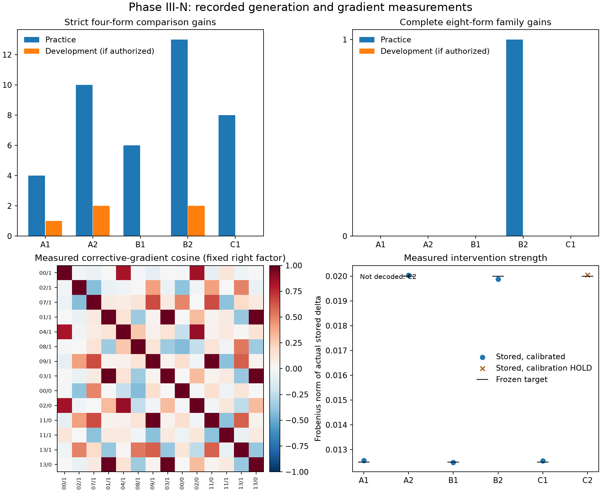

# Phase III-N paired counterfactual adaptation

This study tests supervision allocation in the existing rank-one neural adaptation engine. It begins at Phase III-M commit `178db583894278b9fc52150f8789a1a5f2eadb49`. Historical protocols, checkpoints and results remain unchanged. Sequential learning remains on HOLD until independently verified single-cycle improvement exists.

**Result: HOLD.** Paired supervision completed one previously incomplete practice counterfactual family and gained thirteen strict comparisons without prohibited regressions. Its larger-dose checkpoint gained two strict comparisons on fresh development examples, matching the one-sided comparator, but completed no fresh family. No candidate qualified for preservation validation, independent selection, hidden verification or lineage admission.

## Preregistered comparison

All arms use the original pinned Qwen checkpoint, the exact Phase III-M selected columns and unit right factor, corrective decision-margin gradients, BF16 storage, and the same complete-generation endpoint. For each comparison, its replay-qualified erroneous presentations contribute one averaged gradient. Correct parent responses remain preservation obligations.

Arm A averages eight comparisons from eight families, balanced across distance and correct-answer length. Arm B averages both opposing comparisons from four families, with two close and two far families. Both have eight distinct comparison gradients. The comparison tests supervision allocation, because A also has greater family diversity. No within-family supplemental arm is included in this CPU trial.

Arm C uses the same eight comparisons as B. Its bounded numerical solver maximizes the minimum predicted absolute corrective margin, subject to sampled preservation inequalities and a radius ball. The intercept and gradient for each comparison average the same eligible forks. An average predicted margin does not establish that every constituent decision is correct. The report retains per-fork diagnostics, and actual complete decoding determines admission. Bounded projection failure is not a proof that the permitted parameter space is infeasible.

The target stored update norms are 0.0125 and 0.0200, with a hard maximum of 0.025 and a two-percent matching tolerance. At most six unique complete candidate practice probes are allowed. Identical stored tensors share observations. Every numerical probe restores the exact parent weights.

## Data and gates

Each exact-Decimal truth-flipping family contains two opposing comparisons, two operand orders, and two wordings. All eight presentations remain within one partition. Seven partitions separate adaptation fit, preservation fit, calibration, development transfer, preservation validation, independent selection, and host-held hidden verification. Initial material remains in a private host workspace. Only scored, authorized partitions are published.

A practice candidate must gain a strict four-presentation comparison, correct a repeatable semantic error, preserve every required previously correct response, retain valid completions, exceed its measured positive preservation floors, and satisfy the numerical policy. Development transfer additionally requires a newly complete eight-presentation truth-flipping family. Only a locked survivor can reach preservation validation and independent selection. Hidden verification and exact replay remain separate requirements. No automatic lineage admission or production deployment is permitted.

## Parent and supervision preflight

The unchanged parent completed all 216 adaptation responses validly. It solved 1/48 strict comparisons and 0/24 complete families. Both close-negative subgroups were wrong on all 48 presentations each. The model selected the other displayed operand: always the longer answer in the shorter-correct group and always the shorter answer in the longer-correct group. Each group selected the first and second position 24 times each. This observed pattern is not explained by one global answer-length or operand-position preference. Far-negative correctness was 10/48 for longer-correct and 27/48 for shorter-correct presentations. All 24 positive, mixed-sign and copying control presentations were correct.

The deterministic selection met every quota. A fitted eight comparisons from eight families using thirty qualified forks. B and C fitted eight comparisons from four families using twenty-six forks. Both allocations contain two comparisons per distance/length subgroup. Their union contains fourteen comparisons and forty-eight forks, each differentiated once. Thus comparison budgets match, while family diversity and replay-qualified presentation exposure differ. Correct responses, including correct variants of fitted comparisons, remained protected.

## Local gradient measurements

| Paired fitting family | Distance | Projected gradient cosine | Larger/smaller gradient norm | Local unrounded norm to reach both average-margin ties |
| --- | --- | ---: | ---: | ---: |
| 00 | Close | −0.00827 | 3.154 | 0.02089532 |
| 02 | Close | −0.03862 | 3.200 | 0.02184028 |
| 11 | Far | −0.41315 | 1.276 | 0.01651888 |
| 13 | Far | −0.37749 | 1.175 | 0.01625556 |

The paired mean gives every fitted comparison a positive corrective slope. On the longer-correct member of family 00, its slope changes from −6.21 under A to +5.33 under B. This is a local numerical benefit of the allocation, not evidence that the full answer becomes correct. A and B differ by 29.35 degrees; B and C's preliminary directions differ by 39.27 degrees. Pair-aware synthesis raises its worst predicted averaged margin to approximately −0.377 at unrounded norm 0.020, leaving seven of eight averaged margins negative. No jointly positive witness was found there. The bounded search does not certify global infeasibility.

A separate post-fit calculation minimizes ||u|| subject to b + Au ≥ 0 for each recorded pair, ignoring preservation. Nonnegative two-row KKT multipliers give a numerical primal/dual certificate for the values above. Residuals are below 7e−16 on these well-conditioned matrices. The close-pair bounds exceed 0.020 but remain below the host maximum of 0.025. These bounds concern averaged fixed-prefix margins reaching ties, not complete answers. A positive margin is sufficient for the intended greedy choice; a zero-margin tie depends on native tie breaking. BF16 rounding, earlier divergent trajectories and nonlinear behavior are outside this linear calculation. It did not select, refit or authorize any candidate. [Post-fit bounds](../results/phase-iii-n/paired-v1/local-pair-bounds.json)

## Native replay failure and repair

The initial attempt stopped before constructing any candidate. Repacking selected forks by comparison changed one replayed greedy token. An unchanged-parent audit used twenty-nine forwards and no backwards: the original diagnostic packing had zero mismatches, the repacked comparison batches had one, and the original packing with gradients enabled again had zero. At the offending position two BF16 logits tied at 25.875 and the accepted lower-index token won only in the new packing.

The repair retains the exact original diagnostic batch context and computes derivatives only for selected examples. Context-only rows receive no supervision. It leaves comparison weights, gradients' objective, geometry, roster and admission gates unchanged. All three repeated parent baselines reproduced exact native output rows. The aborted attempt and its source commit are retained separately. Its recorded CPU is a lower bound because the original uncaught exception did not retain whole-process or partial-gradient resource totals. A tested execution wrapper records those totals on future completion or interruption.

## Stored-precision practice results

The frozen calibration rule selected a positive floor of 0.0625 on the fresh calibration population. This uses the same preregistered grid and data-dependent rule as the previous study; no threshold was changed after observing a candidate. Five unique stored states reached full practice generation. All five preserved every required previously correct presentation and valid completion across adaptation and preservation fit. Their measured active margins exceeded the floor.

| Arm and norm target | Actual BF16 norm | Changed entries | New correct practice responses | Strict comparison gain | Complete family gain |
| --- | ---: | ---: | ---: | ---: | ---: |
| A1 one-sided, 0.0125 | 0.01256125 | 14,743 | 30 | +4 | 0 |
| B1 paired mean, 0.0125 | 0.01247911 | 14,701 | 30 | +6 | 0 |
| C1 pair-aware, 0.0125 | 0.01254480 | 14,573 | 19 | +8 | 0 |
| A2 one-sided, 0.0200 | 0.02003005 | 15,340 | 61 | +10 | 0 |
| B2 paired mean, 0.0200 | 0.01988537 | 15,329 | 57 | +13 | +1 |
| C2 pair-aware, 0.0200 | 0.02005234 | 15,108 | Not generated | Not measured | Not measured |

B2 newly completed practice family 09, which was outside B's four gradient-fitting families. Both comparisons were previously incomplete and both became correct under all four presentations. This establishes a complete practice counterfactual correction, not independent transfer: the entire practice population was observed and supplied preservation obligations. A1's four gains were all shorter-correct; B1 additionally gained one far longer-correct comparison. C1's eight gains were all far shorter-correct. Aggregate strict gains alone conceal these differences.

C2 met its numerical norm target but failed the frozen two-pass calibration rule. Its second proposal used an adverse-residual allowance of 0.10994, while remeasurement required 0.16004. It was withheld before generation. No behavioral result is assigned to that state, and the unused sixth probe slot was not filled by an unregistered substitute. Every norm remains within the host maximum of 0.025.

Eight selected preservation anchors cover all required groups and wordings. The five decoded cells A1, B1, C1, A2 and B2 have zero, one, one, zero and one binding local inequalities, respectively. Their smallest remeasured margins are 0.25, 0.25, 0.125, 0.375 and 0.25. Buffered local inequalities and the actual positive-margin guard are separate checks; empirical calibration is not a uniform guarantee on unseen decisions. The raw numeric records distinguish the sampled-anchor count from the binding count.

## Fresh development and qualification

All five practice passers were independently reloaded from disk. The development population contains six new families, twelve comparisons, forty-eight target presentations and twenty-four controls. Its parent solved 2/12 strict comparisons. No candidate lost a previously correct or valid presentation there.

| Candidate | Fresh strict gain | Fresh complete-family gain | Prohibited regressions | Development gate |
| --- | ---: | ---: | ---: | --- |
| A1 | +1 | 0 | 0 | HOLD |
| B1 | 0 | 0 | 0 | HOLD |
| C1 | 0 | 0 | 0 | HOLD |
| A2 | +2 | 0 | 0 | HOLD |
| B2 | +2 | 0 | 0 | HOLD |

The smaller-dose paired allocation gains two more strict practice comparisons than A, but one fewer on development. At the larger dose it gains three more on practice and exactly the same strict comparisons on development. The descriptive family-bootstrap interval for B2 minus A2 practice accuracy is −4.17 to +16.67 percentage points across twenty-four families. The six development family differences are all zero; their degenerate bootstrap interval describes these identical strict outcomes and does not prove population equivalence. B1 minus A1 development accuracy is −8.33 points, with an interval from −25 to 0. C1 gains two more practice comparisons than B1 and has the same zero strict development gain. The larger B/C comparison is unavailable because C2 was not decoded.

All newly strict development corrections under A2 and B2 are shorter-correct close comparisons. No longer-correct development comparison becomes strict. Thus this study supplies no evidence that paired allocation improves complete rule transfer on new families. It does not establish that paired supervision can never help. The full family gate held before any preservation-validation, independent-selection or hidden roster was opened. [Source-bound raw trial](../results/phase-iii-n/paired-v1/trial) · [Replayed analysis and per-family outcomes](../results/phase-iii-n/paired-v1/analysis.json)



## Mechanisms and limitations

Paired supervision improves a harmful local slope and produces a complete practice family under an actual persisted weight edit. That supports a bounded behavioral result. Its practice advantage over one-sided allocation does not survive the fresh complete-family gate. Family diversity and the number of eligible presentations differ between allocations, despite equal comparison budgets and subgroup counts. No same-family four-comparison supplemental arm was run.

The pair-aware solver changes the direction and correction allocation. Its smaller-dose gains concentrate entirely in far shorter-correct cases; it does not improve fresh strict comparisons. The larger-dose calibration failure prevents a behavioral claim about that cell. These results do not justify adopting pair-aware synthesis as a universally better default.

B2 changes six fitted forks to accepted digit tokens and seven to newlines; all thirteen corresponding continuations complete correctly. Its bounded native numerical-token diagnostic records increased termination probability. That subset does not exhaust possible numerical continuations. Whole-generation outcomes remain authoritative. Neither an accepted token nor increased answer-termination probability establishes a semantic rule. No new runtime-only bias experiment was included in this frozen trial.

The proposals share rank-one geometry, but rounding adds components outside the fixed-right subspace. The stored selected-column deltas have numerical rank sixteen and about 5.8–9.3% of their norm outside that subspace. This is an observed BF16 rounding residual, not an additional optimized rank. It limits extrapolation from unrounded local feasibility bounds. All actual stored norms, supports, hashes and cosine comparisons were measured. The two norm cohorts span 0.657% and 0.835% of their target, inside the two-percent matching rule; all six numerical states are distinct.

The measured obstruction is not a proof that rank-one adaptation is globally inadequate. Two close fitting pairs exceed the frozen larger norm in the recorded linear model, other pairs have smaller local bounds, preservation changes some solutions, and nonlinear generation can differ from local predictions. A larger radius, different direction or broader geometry was not silently tried. The study uses one checkpoint, one roster seed and six development families, with narrow synthetic controls rather than a broad capability benchmark.

## Persistence, software and compute

Reusable additions are `paired_supervision.py` for typed comparison allocation and bounded pair-aware synthesis, `paired_update.py` for native-context VJPs, and `experiments/phase_iiin/` for freezing, fitting, independent gates, reconstruction and analysis. Existing adapters, AWL v3, checkpoint policies, trajectory guards and lineage mechanisms are reused. No new agent framework, interface, model download or dependency was added. Architectural portability remains an engineering capability; this natural-task study qualifies only the pinned Qwen endpoint.

The B2 patch independently reconstructed checkpoint SHA-256 `1181e8e4dca827e5bd439e2de0260e4468914667ce55110ff8eb2a1349da5044`, tensor SHA-256 `af47bc11f0d72e6e50d5d4d67004a04bfd0f75df993d3d76ed55a51ac7e52a2c`, 15,329 changed values and norm 0.01988537471. Every live probe restored parent bytes. The original checkpoint remained `7d4532858cf839d05ec34da088114df47238322f86f5e6e5c6693594a21a03b8`. Saved-checkpoint persistence and engineering rollback passed; independent behavioral qualification did not. [Reconstruction receipt](../results/phase-iii-n/paired-v1/reconstruction-B2.json)

The final runtime suite passed 498 tests with one optional MCP skip; the separate MCP environment passed twenty-three tests. K/L/M published analyses replayed exactly. New tests cover comparison budgets and diversity, paired eligibility, gradient weighting and orientation, cancellation, bounded maximin, native replay contexts, restoration, exact-Decimal eight-response scoring, staged access, interruption/restart evidence and local KKT bounds. The final suite recorded an anomalous 9,818.54-second wall time, concentrated in an existing BIC rounded-export test; an earlier complete 490-test run took 43.13 seconds. Both passed. The cause of that wall-time anomaly is unverified, and test CPU is outside experiment accounting.

The completed fit used 209 explicit forward batches, 64 backwards and 2,532 batched greedy steps. Five of the six allowed unique full candidate probes ran. It took 1,255.72 wall seconds; fitting plus fresh-process development took 1,575.99 seconds, about 26.27 minutes. Largest recorded RSS was 2.95 GiB. Across the completed study, diagnostics and recorded part of the aborted attempt, observed work is at least 3,930 model forwards, at least 64 backwards, 2,448 generated response records and 29,376 generated native tokens. Recorded CPU is at least 9,574.64 seconds, about 159.58 CPU minutes. The missing initial partial-gradient CPU prevents an exact grand total. Tests, orchestration and unavailable assistant costs are excluded. No compute-per-verified-improvement ratio is defined because no candidate qualified. [Compute receipt](../results/phase-iii-n/paired-v1/compute.json) · [Execution receipt](../results/phase-iii-n/paired-v1/execution.json)

## Next falsifiable experiment

First freeze a bounded joint feasibility study using each eligible presentation's fork margin, rather than each comparison's average. Check target crossings and preservation simultaneously within the existing 0.025 maximum, including actual BF16 remeasurement. The hypothesis is that the present 0.020 radius is below the selective joint correction threshold for some paired families. Only a measured compatible witness should justify a separately preregistered dose or geometry experiment on fresh families. If no such witness is found, distinguish bounded solver failure from a numerical infeasibility certificate before considering rank two. Do not refit this trial using its disclosed development outcomes. Continual learning remains on HOLD.

## Reproduction

Use the pinned checkpoint and CPU package versions in the environment receipt. Commands below use a private trial workspace and the public fitting and scored-development material. Optional figure rendering needs the existing `figures` dependencies; this run rendered with repository `.venv` Matplotlib 3.11.2 after the model environment correctly reported that Matplotlib was absent.

```bash
git switch dev/phase-iii-n
material=results/phase-iii-n/paired-v1/material
python -m experiments.phase_iiin.audit_previous --out ../previous-audit.json
python -m experiments.phase_iiin.execute --base ./qwen35-base-cpu --material "$material" --out ../paired-trial --receipt ../paired-execution.json
python -m experiments.phase_iiin.verification assess --base ./qwen35-base-cpu --material "$material" --out ../paired-trial
python -m experiments.phase_iiin.reconstruct --base ./qwen35-base-cpu --material "$material" --trial ../paired-trial --arm B2 --scratch ../reconstructed-B2 --receipt ../reconstruction-B2.json
python -m experiments.phase_iiin.archive_trial --source ../paired-trial --material "$material" --out ../public-trial
python -m experiments.phase_iiin.analyze --trial ../public-trial --material "$material" --out ../analysis.json --figure ../comparison.png
python -m experiments.phase_iiin.local_pair_bounds --trial ../public-trial --out ../local-pair-bounds.json
python -m pytest -q
```

Recorded evidence can also be audited without model execution: run `analyze`
against `results/phase-iii-n/paired-v1/trial` and the public material, using a
fresh output filename. Recompute cost with
`python -m experiments.phase_iiin.compute --root results/phase-iii-n/paired-v1 --out ../compute-replay.json`.
The source-bound K/L/M archive audit similarly executes no neural experiment.

The original private host material retains unscored preservation-validation, selection and hidden populations, committed by hash. Public replay needs none of them because the development gate stopped this study. Fresh rosters can be frozen with `semantic_roster --material <private-path> --hidden-out <separate-private-path>` before a new study, never by overwriting this one. No checkpoint entered accepted lineage; main and all historical experimental archives were left unchanged.

## Mathematical details

For fork j of comparison i, the corrective margin is hᵢⱼ = max(z over accepted tokens) − max(z over rejected tokens). Native vocabulary order resolves ties. With the pinned right factor v and selected columns, aᵢ is the arithmetic mean of (∂hᵢⱼ/∂W) v across that comparison's eligible variants. The comparison intercept bᵢ averages the same parent margins. Each comparison has total weight 1/8, regardless of its number of qualified variants. No item normalization or new geometry estimation is used.

The A and B preferred directions are their respective means of eight aᵢ rows. C searches for a bounded numerical witness maximizing minᵢ(bᵢ + aᵢᵀu). All use gₚ + Bₚu ≥ ε + δ for sampled preservation decisions. The solver uses the inherited halfspace-and-ball projection, at most sixteen bisection steps, forty-eight projection iterations per call, and tolerance 1e−7. Its numerical search ceiling is not a certified optimum. It retains individual predicted margins and never interprets a favorable mean as full-generation correctness.

For each family, gradient agreement is a₀ᵀa₁/(||a₀||||a₁||), with undefined agreement recorded for zero vectors. Adding supervision does not change either derivative at the fixed parent. It changes the aggregate direction and therefore the two directional effects a₀ᵀu and a₁ᵀu. A negative cosine alone does not prove incompatibility.

The actual intervention is round_BF16(W + uvᵀ) − W, evaluated in the authorized columns. Numerical norm matching and prefix replay inspect this stored delta, not merely ||u||. The final endpoint checks complete greedy answers by exact Decimal equality. A strict comparison requires four correct presentations; a complete family requires eight. Family-cluster bootstrap intervals keep all related presentations together and are descriptive for the frozen cohort.
