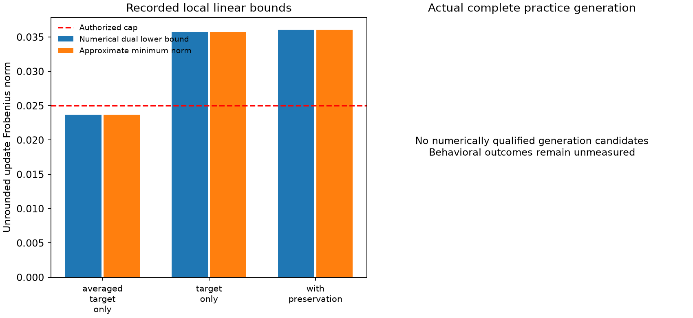

# Phase III-O joint behavioral feasibility

This study begins at `e2dbbf353501dddab927c850414ab5938381380d` on Phase III-N. It tests whether all required first-fork decisions for two opposing-outcome families can coexist in the existing fixed-right rank-one space. Historical evidence, model checkpoints and evaluation gates remain unchanged.

The prospective design selects one close and one far paired-error family from fresh authorized practice. Every wrong presentation must supply a validated native-context gradient; every parent-correct presentation remains protected. All eight presentations stay tied to their semantic family.

Three numerical formulations compare averaged comparison constraints, individual target-only constraints, and individual targets plus sampled preservation constraints. Minimum-norm witnesses, dual lower bounds, bounded numerical failures and actual generation remain separate evidence levels. No global nonlinear impossibility claim follows from local failure.

The strictly positive target margin is fixed at 0.0625. The two target stored norms are 0.0200 and 0.0245, with the existing 0.025 hard cap on both proposed and native stored updates. At most four unique full-generation probes are allowed: ordinary paired-mean reference A and preservation-compatible joint method C at each radius. B is a numerical diagnostic, with no fallback slot. Every individual predicted and remeasured target margin, preservation rule and native numerical budget must qualify before decoding.

The current checkpoint, layer, selected columns, right factor and AWL v3 interface are retained. This phase does not optimize a new right factor, expand rank, change layers, deploy a model or authorize automatic lineage admission. Later evaluation partitions stay private until the existing host gates pass.

## Result: HOLD at the local numerical gate

The frozen experiment ran on the real pinned Qwen checkpoint. Averaging four
comparison constraints admits a local correction below the 0.025 cap. Requiring
all sixteen individual decisions raises the approximate minimum norm to
**0.035805**, before preservation. Adding eight protected decisions raises it
to **0.036063**. Numerical dual certificates independently support both bounds.

Each target decision, considered alone, fits below the cap. Each complete
family, considered jointly, exceeds it. The measured obstruction is therefore
the combination of required decisions in this fixed-right local update space,
rather than a single unreachable fork or principally the preservation sample.

No candidate qualified for full generation. Development transfer, preservation
validation, independent selection and hidden verification remained unopened.
There is no new persistent improvement or lineage admission. This result does
not establish nonlinear, BF16, general rank-one or task-level impossibility.

## Historical audit and frozen identities

The read-only audit exactly replays the published K, L, M and N analyses and
N's averaged-margin local certificates. Historical results remain unchanged:
teacher-forced improvements previously damaged generation; I produced useful
practice corrections with regressions; J and K failed subsequent qualification;
L gained independent corrections but failed sealed preservation; M and N
produced development gains without complete-family transfer. N's paired arm
completed one practice family, not a fresh development family.

Evidence is under [results/phase-iii-o](../results/phase-iii-o/). The primary
experiment is a single run, `joint-v1`; its artifacts are observations of that
run, not independent replications.

| Identity | SHA-256 |
|---|---|
| Original checkpoint | `7d4532858cf839d05ec34da088114df47238322f86f5e6e5c6693594a21a03b8` |
| Frozen O protocol | `b43e2d5cd1712cfd0158ddf5be9078fab999b9ad167f810b1d4c41a8642bcfc1` |
| Seven-partition manifest | `8acbfac8cce5d6904c47bb7dd70f43f79b952eead3c98682983b92ab0af47586` |
| Completed fitting report | `4a07fec76d0f23ff647fecff578ac7d4626ee7d605922f72deacba27416f5267` |
| Raw joint systems and certificates | `b62bdae0c318cdc248c1d37305a746c23aa2797f8ee459ccdde8a9368c66d2d2` |

The exact M basis and fit-report identities are checked by
`trial/reference-geometry.json`. All sixteen selected columns and the unit
right factor are reused exactly. The adapter supplies the eligible affine
module; the common solver contains no Qwen tensor names. AWL v3, model
capability contracts and the existing endpoint/patch/verification architecture
remain intact. The scientific model test is Qwen only; passing the existing
Llama adapter tests is an engineering regression check, not a new Llama study.

## Implemented mathematics

For each validated wrong presentation, retain its native first-fork context,
accepted token set, strongest rejected token, parent margin and projected
corrective margin derivative. With fixed unit right factor \(v\), the proposed
selected-column update is \(\Delta W=uv^T\), so its unrounded Frobenius norm is
\(\|u\|_2\). The target system is

\[
 h_j+a_j^Tu\geq 0.0625.
\]

Protected decisions add \(g_p+b_p^Tu\geq\tau_P\), where the frozen selection
rule chose \(\tau_P=0.125\) from the measured parent margins. Eight anchors
cover target, positive, mixed-sign and copying groups, with both wordings
represented in every group. This is sampled protection; complete-generation
checks would still be required for any admitted candidate.

The bounded solver minimizes \(\frac12\|u\|^2\) under all supplied inequalities
\(Au\geq b\). It uses row-normalized Hildreth dual coordinate ascent on a small
Gram matrix, not a model-scale Jacobian or Hessian. It records primal residuals,
dual multipliers, active constraints, norm bounds and bounded-search failures.
An unrestricted diagnostic minimum may exceed the authorization radius; it is
never returned as an admissible update.

For any nonnegative multiplier vector \(\lambda\), weak duality supplies

\[
 \|u\|\geq\sqrt{\max(0,2[\lambda^Tb-\tfrac12\|A^T\lambda\|^2])}.
\]

The Cauchy bound \(\|u\|\geq\max(0,\lambda^Tb)/\|A^T\lambda\|\) is also
checked when its denominator is nonzero. Conservative floating-point padding
is applied before reporting either bound. The public analyzer independently
recomputes both from the original rows and recorded multipliers. Exact zero-row
and exactly opposed-row contradictions are distinguished from radius failures;
near-opposed rows do not establish infeasibility at every radius.

The new reusable modules are `joint_feasibility.py` and `joint_update.py`.
They distinguish local norm obstruction, preservation conflict, numerical
search failure, stored-precision refusal, corrected forks with wrong complete
answers, and endpoint success. Native target remeasurement and full generation
remain mandatory before any practice candidate can be admitted. The existing
host verifier and lineage authority are reused through isolated O bindings.

## Fresh population and parent diagnosis

Seven semantic-family partitions were committed before fitting. Counts below
are target families; each contains two opposing comparisons, both operand
orders and both wordings. Additional positive, mixed-sign and copy controls
are included in each partition.

| Partition | Families | Total presentations | Opened in this study |
|---|---:|---:|---|
| Adaptation | 16 | 152 | Yes |
| Preservation fit | 4 | 56 | Yes |
| Calibration | 4 | 56 | Yes |
| Development transfer | 6 | 72 | No |
| Preservation validation | 4 | 56 | No |
| Independent selection | 8 | 88 | No |
| Hidden verification | 8 | 88 | No |

Previously disclosed operands and related family anchors are excluded by the
inherited exact-Decimal generator. Counterfactual relatives, operand reversals
and wordings stay in one partition. Only the three opened rosters and the
seven-partition commitments are public. The host-held hidden roster and its
seed are absent from the checkout.

The parent produced 151 valid adaptation responses out of 152. It completed
0/32 strict target comparisons and 0/16 full target families. This stricter
four-presentation measure differs from the inherited qualification screen,
which tests order-specific two-wording competence and repeatable errors.
The frozen qualification screen passed; its thresholds were not changed.

The prospective fitting rule selected close family `target/00` and far family
`target/09`. All eight presentations in each were valid semantic errors with
replay-qualified forks. All sixteen native parent margin remeasurements matched
the gradient contexts exactly. The four answer-length/distance groups are
represented. Every parent-correct response outside this fit remains a
preservation obligation.

## Controlled numerical comparison

A's diagnostic replaces each comparison's four inequalities by their average.
B retains all sixteen individual inequalities. C adds the eight preservation
anchors to B. All use the same checkpoint, gradients, right factor, target
floor, local norm cap and numerical solver settings.

| System | Averaged target minimum | Individual target minimum | Individual + preservation minimum |
|---|---:|---:|---:|
| Close family alone | 0.01868579 | 0.02743403 | 0.02743403 |
| Far family alone | 0.01836303 | 0.02867829 | 0.02916385 |
| Both families | 0.02366626 | 0.03580476 | 0.03606346 |

These are approximate minima of unrounded local systems. The global individual
and protected numerical norm lower bounds are respectively
`0.03580476112939881` and `0.0360634629127738`. Both exceed 0.025 by much more
than the recorded numerical residuals. The largest single-decision minimum is
only `0.0212920985495462`; no individual target halfspace alone excludes the cap.

For a single target row, the minimum is
\(\max(0,0.0625-h_j)/\|a_j\|\). The table identifies each fork by
family/comparison/operand-order/wording; all values use the same fixed right
factor. Their simultaneous cost is not the maximum of these separate costs.

| Fork | Parent margin | Individual minimum norm |
|---|---:|---:|
| 00 / 0 / 0 / 0 | -2.500 | 0.02129210 |
| 00 / 0 / 0 / 1 | -2.000 | 0.01595488 |
| 00 / 0 / 1 / 0 | -2.000 | 0.01668364 |
| 00 / 0 / 1 / 1 | -1.500 | 0.01200368 |
| 00 / 1 / 0 / 0 | -0.875 | 0.01877504 |
| 00 / 1 / 0 / 1 | -0.500 | 0.01067206 |
| 00 / 1 / 1 / 0 | -0.375 | 0.00746066 |
| 00 / 1 / 1 / 1 | -0.250 | 0.00512126 |
| 09 / 0 / 0 / 0 | -0.500 | 0.01323694 |
| 09 / 0 / 0 / 1 | -0.250 | 0.00722222 |
| 09 / 0 / 1 / 0 | -0.625 | 0.01578316 |
| 09 / 0 / 1 / 1 | -0.250 | 0.00691400 |
| 09 / 1 / 0 / 0 | -0.750 | 0.01561070 |
| 09 / 1 / 0 / 1 | -0.125 | 0.00359967 |
| 09 / 1 / 1 / 0 | -0.625 | 0.01247516 |
| 09 / 1 / 1 / 1 | -0.250 | 0.00567023 |

Replacing averages with individual constraints increases the joint approximate
minimum by about 51.3%. Adding the sampled preservation constraints increases
the individual-target minimum by about 0.72%. This supports a specific
average-versus-individual mismatch on this fresh cohort. It does not prove that
this mechanism explains all earlier failed edits: those studies used different
families, objectives and target thresholds.

The average-constrained QP minimum is a numerical diagnostic, **not** the norm
of the historical ordinary-mean direction. The actual A proposal preserves
that mean-direction construction. C proposes the within-cap joint witness if
one exists, then searches only along its ray under the preregistered rule.
These two proposal mechanisms were authorized at target stored norms 0.0200
and 0.0245, with 2% matching tolerance and at most four unique full-generation
states. B had no decoding slot.

All four A/C cells were refused before native candidate/final generation:
A failed the required individual predicted margins, and C lacked a joint
witness inside the cap. No candidate reached direction-specific residual
calibration. A missing calibration result is not a zero-error calibration.
The full eight-presentation matrices retain unmeasured candidate outcomes as
`null`, not as false predictions or zero gains.



## Stored precision, restoration and evaluation boundaries

Two temporary BF16 preservation secants were executed at nominal norm 0.0125
while collecting directional diagnostics. They changed 14,780 and 14,570
entries, at realized norms 0.0125539853 and 0.0125630710. They measured 613
protected positions on 77 prefixes each, changed no sampled greedy argmax,
reported no parent replay mismatches, and restored the original live tensor
exactly. Their tensor hashes and residuals are retained in `trial/secants.json`.
They are diagnostics, not practice-qualified model candidates or independent
behavioral improvements.

There were **zero** candidate complete-generation probes and **zero** saved
candidate checkpoints. Consequently, actual candidate BF16 target margins,
complete corrections, family transfer, fresh-process candidate reload and
candidate rollback are untested here. The original checkpoint hash was checked
again after fitting. Its identity and all temporary live restorations passed.
No new reconstruction receipt is fabricated for an absent candidate.

The independent host assessment replays the fit identity and records HOLD with
an empty development lock. No development worker was launched; later rosters
were not read. Independent selection, hidden verification, lineage acceptance
and sequential learning remain on HOLD.

## Computation and tests

The completed fitting process and host assessment used **1,869.890625 CPU
seconds**, **356.2051 wall seconds** and peak RSS **2,675,830,784 bytes** (about
2.49 GiB). This includes diagnosis, derivatives, secants, failed numerical
proposals and imports inside the execution wrapper, counted once. Recorded
work is 78 explicit forwards, 396 greedy batched steps, 32 backwards and 264
generated parent responses containing 3,168 native tokens. No GPU, remote
inference or new model download was used. Assistant token/tool costs are
unavailable. Test, analyst-replay and orchestration costs are separate.

The reference environment is Windows 11, Python 3.12.10, PyTorch 2.15.0,
Transformers 5.22.1, NumPy 2.5.4 and native BF16, with six inference threads.
Full environment and test receipts are public. Runtime tests run with a
Torch-only initial thread limit; the original BLAS environment is retained.
The optional MCP suite runs in the repository environment with MCP installed.

The initial full runtime suite passed **554 tests with one optional MCP skip**;
the separate MCP suite passed **23 tests**. The final full suite passed
**563 tests with the same optional skip**, in 46.24 seconds. Analysis tests verify
independent dual arithmetic, native per-fork completeness and unmeasured
behavior handling. The final post-report suite and clean-checkout receipts
are recorded separately under the result directory. Runtime test CPU is
53.65625 seconds; the final main process peak is 376,717,312 bytes. These costs
are not added to experimental compute. The initial compute report is preserved;
`compute-v2.json` additionally itemizes the two temporary secants and their
29,350 changed-entry events, without mistaking them for decoded candidates.

Two preflight adjustments are recorded, without altering historical evidence:
Windows source/protocol line endings were canonicalized before freezing; and
setting OMP/MKL thread variables changed four old N rounding-residual metadata
values by at most 1.39e-17. Restoring the original BLAS environment reproduced
the archives exactly. No audit tolerance changed. An existing BIC test's old
wall-time anomaly did not recur in the bounded O preflight; its cause remains
unproven. New tamper fixtures explicitly forge invalid bytes rather than asking
the write-once evidence writer to overwrite a receipt.

## Interpretation, limitations and capacity decision

The experiment supports the need to constrain individual generative decisions
instead of inferring complete correction from their average. It also supplies
a bounded reason to stop searching doses of this fixed-right local geometry.
It does not demonstrate a new neural correction.

The solver certificates concern finite, parent-linearized inequalities, not
the nonlinear model. Derivatives inherit native-runtime approximations. The
reported lower bound can exceed the approximate primal norm by around 1e-10
because the latter is feasible only to the stated numerical tolerance. The
raw primal and dual residuals are available; this is not a formally verified
interval proof. BF16 rounding can leave the exact rank-one subspace. Alternate
valid continuations, different first forks or nonlinear effects could evade
the local obstruction. Protection covers eight selected decisions, not every
possible behavior. Two families and one checkpoint do not support a
population-level reachability claim or a confidence interval on improvement.

The evidence-gated capacity recommendation is
**`optimized_right_factor_rank_one`**. A separately frozen follow-up should
test whether optimizing the right factor within the same authorized columns,
layer, rank and norm reduces the joint individual-target cost while retaining
protection. The falsifiable hypothesis is that a different unit right factor
admits a within-cap witness which survives native BF16 remeasurement and the
unchanged full-generation guard. Failure would justify investigating a
broader representation only after recording that result. No such optimization,
rank-two update, second layer or new model was implemented in O.

Engineering portability remains available. Behavioral deficiency is qualified.
Selective persistent improvement and sequential learning remain unproven.

## Reproduction

Run from the repository root with the recorded NumPy environment and default
OMP/MKL settings. Choose fresh output paths; evidence writers reject overwrites.
Archived numerical replay requires no model runtime or private evaluation data:

```powershell
python -m experiments.phase_iiio.audit_previous --out "$env:TEMP/wb-o-prior-audit.json"
python -m experiments.phase_iiio.analyze `
  --trial results/phase-iii-o/joint-v1/trial `
  --material results/phase-iii-o/joint-v1/material `
  --out "$env:TEMP/wb-o-analysis.json"
python -m experiments.phase_iiio.compute `
  --root results/phase-iii-o/joint-v1 --out "$env:TEMP/wb-o-compute.json"
python -c "import torch,pytest; torch.set_num_threads(6); raise SystemExit(pytest.main(['-q','tests']))"
```

For a new model run, first use `experiments.phase_iiio.semantic_roster` to
freeze fresh host-private material and a distinct hidden path. Then invoke
`experiments.phase_iiio.execute --base <pinned-checkpoint> --material <private-material>
--out <fresh-trial> --receipt <fresh-execution-receipt>`, followed by
`experiments.phase_iiio.verification assess` with the same base/material/trial.
Do not use a disclosed development or hidden roster for a new independent
study. The public fitter inputs reproduce this run's numerical evidence; the
unopened host partitions are intentionally not published.

Primary evidence: [analysis](../results/phase-iii-o/joint-v1/analysis.json),
[raw systems](../results/phase-iii-o/joint-v1/trial/joint-feasibility.json),
[fit report](../results/phase-iii-o/joint-v1/trial/fit-report.json),
[assessment](../results/phase-iii-o/joint-v1/trial/assessment.json),
[historical audit](../results/phase-iii-o/previous-audit.json).
