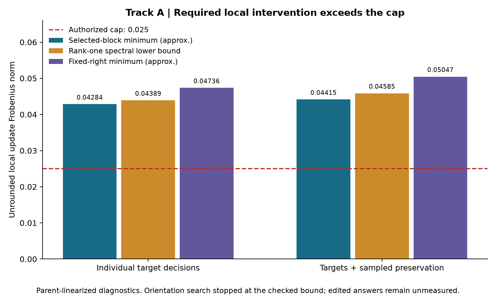
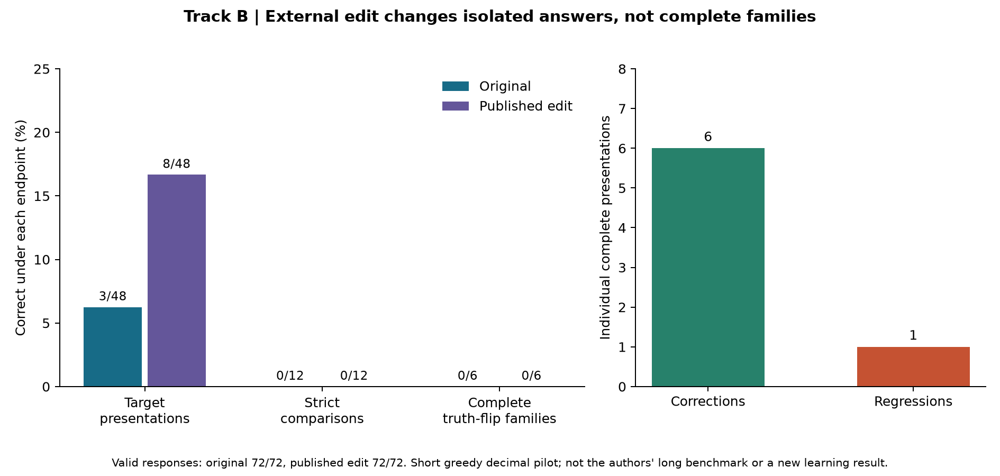
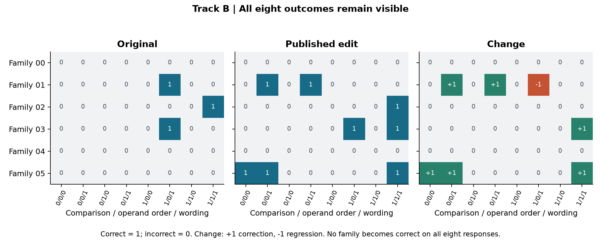

# Phase III-P: optimized-right adaptation and an external reference study

Starting commit: `59f207e2271ef7471f0a80389143d7055c2459f8`, isolated branch
`dev/phase-iii-p`. Main, historical evidence, original models and accepted
lineage remain unchanged.

## Prospective Track A

Track A tests one changed geometric restriction: optimize the unit right factor
of the rank-one update in the existing layer-23, sixteen-column affine region.
The parent checkpoint, endpoint, individual target requirements, preservation
rule and proposed/native norm cap of 0.025 remain fixed. The inherited right
factor is the reference, not an external edit direction.

Fresh semantic-family populations are frozen into the existing seven roles.
One close and one far paired-error family are chosen by the Phase III-O
practice-only rule before feasibility outcomes. Full selected-block derivatives
retain original native diagnostic contexts and every required individual fork.

Target-only and protected selected-block relaxations are solved through bounded
small Gram systems. Checked over-cap lower bounds stop the corresponding
orientation search. Relaxed matrices are diagnostic only, never candidate
patches. A below-cap relaxation does not establish rank-one feasibility.

The single outer procedure has at most four deterministic fitting-derived
starts, eight iterations and four line-search trials per iteration. Inner
convex solves retain original-row dual multipliers, including over-cap minima
as diagnostics. Exact settings and start rules are in the frozen protocol.
No new orientation may be chosen using later candidate behavior.

Four full-generation slots are reserved: fixed-right and optimized-right minimum
protected witnesses, and a separately identified norm-matched pair at stored
norm 0.0245 (2% tolerance). Inadmissible cells remain unmeasured; there are no
replacement slots. Individual predicted and native BF16 margins, direction-
specific calibration, unchanged full-generation guards, exact restoration,
fresh transfer and host-owned later stages remain mandatory.

The environment preflight verified the required checkpoint hash and exact
historical O replay in the recorded CPU environment. No replacement model,
paid compute, rank expansion or alternate layer is authorized in this trial.

## Separately scoped Track B

Only after Track A finishes, inspect the pinned published repetition edit and
its code, provenance, license and tensor manifest. Track B cannot contribute
data, directions, parent weights, ranking or decisions to Track A. It requires
an explicit isolated reference policy and exact source/edited tensor hash
checks before inference.

Any reference comparison uses fresh reference-only families and identical
short greedy decimal endpoints for original and reference checkpoints. It
measures an external intervention under our endpoint. It is not a reproduction
of long sampled thinking benchmarks or evidence that loop repair teaches the
decimal ordering rule. Incompatibility or missing execution capability produces
a recorded HOLD rather than a substituted model.

The preceding design was committed before execution. The results below preserve
its numerical limits and admission gates.

## Result and scope

**Track A: HOLD at the selected-block lower-bound gate.** The target-only
relaxation requires approximately 0.04284, exceeding 0.025 before preservation.
Its independently checked bound stops all right-factor orientation searches.
No candidate generation, development transfer or independent evaluation ran.

**Track B: external benchmark completed; preservation qualification fails.**
The exact reconstructed published edit changed target correctness from 3/48
to 8/48 presentations: six corrections and one regression. Neither model
completed a strict four-presentation comparison or an eight-presentation
counterfactual family. This is a measured external behavioral effect, not a new
WeightBridge learning result or zero-regression improvement.

The immediate negative-decimal improvement goal remains unqualified. Main,
historical archives, original checkpoint and accepted lineage are unchanged.

## Identities and historical replay

| Artifact | Identity |
|---|---|
| Starting research commit | `59f207e2271ef7471f0a80389143d7055c2459f8` |
| Track A implementation and preregistration | `6e43a9c` |
| Track A frozen protocol SHA-256 | `4b7112cf7a708b9c49df73578875def4cf8b33fa15e8a1afd809dc6c68c253e7` |
| Track A fitting report SHA-256 | `35beb45846cc68e014d4a3b83fa66484d310b75b93c43378d2bb21523b014f11` |
| Original checkpoint SHA-256 | `7d4532858cf839d05ec34da088114df47238322f86f5e6e5c6693594a21a03b8` |
| External source revision | `4d09ba6d6a7e891dd8063974dfe81b3d78e3494f` |
| Published Qwen source revision | `2fc06364715b967f1860aea9cf38778875588b17` |
| External manifest SHA-256 | `83185c1db46e3dafb34af645f8c5ce033c09cc99d4512b9e1b8e3aba9d269225` |
| External NPZ SHA-256 | `e92a92aafd1f1068b4fd94aa0fbe081ba3ddea2047ee7bcac7161d861be299e7` |
| Reconstructed reference checkpoint SHA-256 | `6cb1d9fd8d6df43db6c9c5d8b87e6ddd489295333d4f65867660ea3393c9e556` |

The preflight exactly replayed the historical K/L/M/N numerical audit and the
O analysis without modifying their evidence. It verified the local checkpoint
hash, Python 3.12.10, Torch 2.15.0, Transformers 5.22.1, NumPy 2.5.4 and
safetensors 0.8.0. The run used native BF16 on CPU with six inference threads.
No replacement base, new package, GPU service or paid inference was used.
The existing PyTorch fallback kernels remained unchanged.

An initial preflight import named a nonexistent `checkpoint_hash` function;
it was corrected to the existing `load_checkpoint().checkpoint_sha256()` before
inference. The recorded checkpoint and runtime were not substituted. The
accompanying math-preflight file was not found in the checkout or attachment
filenames; independent deterministic algebra fixtures were implemented instead.

## Track A mathematics and implementation

For every selected target fork and protected decision, retain the full
authorized block \(G_j\in\mathbb R^{1024\times16}\), native prefix, accepted
set, strongest rejected token, original batch context, parent margin and
semantic identity. Context-only rows reproduce execution conditions without
receiving supervision. The collector retains only selected columns after each
transient VJP and verifies unchanged parent bytes.

For required margin change \(b_j\), the local rank-one constraint is
\(u^TG_jv\geq b_j\), \(\|v\|=1\), \(\|u\|\leq0.025\). Normalization and
canonical sign changes preserve \(uv^T\). The inherited right factor, columns,
layer and rank remain the reference geometry.

First solve the selected-block relaxation

\[
 \min_D\tfrac12\|D\|_F^2\quad\text{subject to}\quad
 \langle G_j,D\rangle_F\geq b_j.
\]

The new bounded Gram interface uses \(K_{ij}=\langle G_i,G_j\rangle_F\), with
at most 64 rows and blocks no larger than 1024 by 16. It does not bypass the
existing vector solver's dimension guard by flattening a large matrix into it.
Relaxed matrices are diagnostics and cannot enter the patch engine.

For any nonnegative original-row dual vector \(\lambda\), let
\(S=\sum_j\lambda_jG_j\). Weak duality and Cauchy bounds constrain the relaxed
norm, while rank-one updates additionally satisfy

\[
 \|uv^T\|_F\geq
 \frac{\max(0,\lambda^Tb)}{\|S\|_2}.
\]

The implementation includes conservative numerical padding and explicit zero
denominator handling. A separate checker reconstructs the weighted matrix in
an explicit row loop and obtains its spectral norm through a small eigenproblem
rather than the production SVD path. It independently verifies inputs,
multipliers, arithmetic, padding and claimed radius exclusions. These remain
floating-point certificates, not formally verified interval proofs.

Only an admissible relaxation permits the bounded multistart right-factor
search. For each unit \(v\), the existing convex inner solver minimizes
\(F(v)=\frac12\|u\|^2\). When KKT checks qualify it, the outer derivative is
\(-\sum_j\lambda_jG_j^Tu\), projected onto the sphere tangent. Original-row
multipliers are essential; normalized-row multipliers do not give this
derivative. Deterministic tests check finite differences away from transitions,
factor invariance, disconnected fixed-right examples, relaxed feasibility
without a within-cap rank-one witness, degeneracy and bounded failure.

The frozen method allows four fitting-derived starts, eight iterations and
four backtracking trials: at most 132 inner solves per local system. Target-only
and protected searches are separate. An over-cap inner minimum would remain
diagnostic. The four candidate slots distinguish minimum protected witnesses
from a separate actual stored-norm comparison at 0.0245 with 2% tolerance.
Two same-orientation calibration passes are allowed; no later outcome can
select a new right factor. All old native and complete-generation gates remain.

New reusable modules are `selected_block.py` and `right_factor_geometry.py`.
The existing AWL v3, adapters, patch engine, native replay, preservation sampler
and independent verifier are reused. No universal controller, new framework,
production integration or UI was added.

## Track A population and measurements

Seven fresh partitions contain 16/4/4/6/4/8/8 target families for adaptation,
preservation fit, calibration, development transfer, preservation validation,
selection and hidden verification. All opposing outcomes, operand orders and
wordings stay together. Previously disclosed O and earlier families are excluded.
Only the first three partitions were opened and published; later populations
remain host-private.

The parent completed 152/152 adaptation presentations validly, but solved 0/32
strict target comparisons and no complete target family. The inherited
qualification screen passed its separate order-specific two-wording controls
and repeatable-error rules; thresholds were not changed. The prospective rule
selected one close and one far family, each with both counterfactual comparisons.
Fourteen wrong presentations supplied replay-qualified gradients. Two already
correct presentations remained preservation obligations, not training errors.

Eight protection anchors represent target, positive, mixed-sign and copying
groups with both wordings. Eight separate calibration anchors selected the
positive preservation floor 0.0625 through the committed rule. The target
floor remains 0.0625. All native derivative intercepts matched their original
diagnostic contexts exactly.

| Local system | Relaxed minimum, approximate | Checked relaxed norm lower bound | Checked rank-one lower bound | Fixed-right minimum, approximate |
|---|---:|---:|---:|---:|
| Individual targets | 0.04284276 | 0.04284276 | 0.04389025 | 0.04735891 |
| Targets + sampled preservation | 0.04415019 | 0.04415019 | 0.04585481 | 0.05046530 |

Both relaxed lower bounds exceed 0.025. The target-only obstruction exists
before preservation; adding protection increases the required local cost.
The optimizer correctly records **zero outer-search inner calls**. This is
an admission refusal based on a checked bound, not a failed orientation search
or proof that optimizing a right factor is generally ineffective.

All four candidate cells are unmeasured. No native candidate correction,
stored candidate rank, generated candidate answer, matched-strength causal
comparison, candidate checkpoint, fresh transfer or independent qualification
exists. They remain `null`/UNMEASURED rather than zero gains or successful tests.
The host assessment records HOLD and launches no later evaluator.

Two authorized temporary preservation secants were measured at nominal norm
0.0125. Their realized BF16 norms were 0.0125643905 and 0.0125525662, changing
14,776 and 14,562 entries respectively. Both restored the exact parent tensor.
They are prefix diagnostics, not candidate generation or neural improvements.
The full original checkpoint hash was rechecked after fitting.



Unlike O's fixed-right bound, this relaxation covers arbitrary matrices in the
same selected-column block. Increasing rank to two in that unchanged block
cannot satisfy this **recorded linear system** below the cap. Actual BF16
rounding also stays within that column block, even when it creates additional
numerical rank. Nonlinear effects, approximate native derivatives, alternative
valid continuation paths or a different parameter region can invalidate a
broader neural-impossibility inference. No such global claim is made.

## Track B source audit, compatibility and reconstruction

Track A finished and its host HOLD was recorded before Track B source work.
The reference supplied no A examples, directions, rankings, parent checkpoint
or evaluation decisions. Its data and authorization are separate.

The pinned audit inspected README, LICENSE, Experiment 8 README, both requested
p50c reports, manifest, NPZ, `apply_edit.py` and its `st_numpy.py` helper. The
external code was inspected but never executed. Its scripts use MIT; the
authors' data, logs and patch use CC BY 4.0. Complete notices, source URLs,
byte hashes and attribution are retained in the reference archive.
The pinned base-model Apache-2.0 license is also included for the sparse
before/after values in the reconstruction receipt. No full model is distributed.

The authors report 579 rescues and five losses on 1,152 held-out **practice**
problems under long sampled thinking-enabled evaluation. Those are their
claims, not our measurements, and they do not establish zero-regression
adaptation. [Pinned final report](https://github.com/RikiyaT/lm_understand-logs/blob/4d09ba6d6a7e891dd8063974dfe81b3d78e3494f/exp8_math/runs/p50c/work_notes/final_report.md)

Both required BF16 source tensors match the manifest. Local config, tokenizer,
tokenizer config and chat template match the pinned HF revision metadata.
The authors' text export declares `Qwen3_5ForCausalLM`; our local checkpoint
uses `Qwen3_5ForConditionalGeneration`, with matching relevant text structure.
These checks establish precise patch/asset compatibility, not equivalence to
the authors' complete runtime or published benchmark setup.

The separate exact-artifact authorization permits only the pinned manifest,
NPZ, original checkpoint and two specified tensors. It does not change A's
0.025 norm or 16,384-entry envelope. Reconstruction through WeightBridge's
existing patch engine produced these exact edited hashes:

| Tensor | Edited SHA-256 | Actually changed BF16 entries | Absolute norm | Relative to full affected matrix |
|---|---|---:|---:|---:|
| Layer 15 MLP output | `82e2d733ea64feaeb4af93a1e065641d3df98b494a8b7576ef2f52e90fe2ee53` | 65,260 | 1.74888762 | 0.10636181 |
| Layer 19 MLP output | `8ef3c61bc36af113ad58e89dbb0a4a14dcba5a45cb750c15ab515c82ddd12eb2` | 64,928 | 1.39876319 | 0.08106277 |

Total actual changes are **130,188 entries**, distinct from 131,072 nominal
selected coordinates. Combined absolute norm is **2.23945225**; relative to
the combined full affected matrices it is **0.09395607**. Small differences
from authors' reported relative norms reflect the measured BF16/float64
calculation; the edited bytes match exactly. No total-model parameter fraction
is used as a substitute for either track's norm measurement.

The candidate is a distinct private model directory. Its two edited tensor
hashes and original-checkpoint restoration checks pass before inference.
The full model is not redistributed. No reference patch was combined with A.

## Track B frozen endpoint outcomes

A separately committed protocol samples six fresh truth-flipping families,
four positive/mixed-sign controls and four copying items. A sign-preserving
integer translation of 1000 places the numbers in a deliberately distinct
domain without opening any private A partition. Decimal oracle, wordings,
operand orders and fractional representations are preserved. This changes
tokenization and difficulty, so B is not a matched causal comparison with A.

The original and reconstructed models were each loaded in a separate process,
using identical unrestricted greedy decoding, twelve new tokens, one beam and
the exact completed-decimal endpoint. No fitting, tuning or candidate selection
used this roster.

| Measured outcome | Original | Published edit |
|---|---:|---:|
| Correct target presentations | 3/48 | 8/48 |
| Strict target comparisons, all four forms | 0/12 | 0/12 |
| Complete truth-flipping families, all eight forms | 0/6 | 0/6 |
| Completed and valid responses, including controls | 72/72 | 72/72 |
| Decodes ending at the twelve-token budget | 72/72 | 72/72 |
| Correct non-target control presentations | 24/24 | 24/24 |
| Correct responses across the full roster | 27/72 | 32/72 |

Six target responses improve and one previously correct response regresses.
All six corrections are in far-comparison families. The complete raw outputs,
individual losses and eight-response matrices remain visible. A positive
presentation gain cannot cancel the prohibited loss or substitute for strict
comparison/family correction. The external benchmark is completed; a
zero-regression adaptation qualification fails.

Here "completed" means an observed completed first decimal line, exactly as
the endpoint specified before evaluation. Every decode still reached the
twelve-token cap; neither run demonstrates unrestricted EOS termination or
long-form reasoning completion. This short endpoint is deliberately not a
substitute for the authors' long sampled runs. Raw texts and stop reasons are
retained rather than being recast as successful full-length benchmark answers.





Uncertainty is clustered by six underlying families. The existing strict
comparison bootstrap interval is [0, 0] because every strict family-level
comparison gain is zero. That degenerate empirical interval is not proof of
no population effect. A separate presentation-level clustered estimate and
its limitations are in the reference analysis. Repeated renderings are not
treated as independent samples.

For target **presentation** accuracy only, the descriptive clustered bootstrap
estimates a 10.42 percentage-point gain with an interval of approximately
[2.08, 22.92] points (six families, 4,000 resamples, seed 1996). This post-fit
estimate did not select a candidate or change a gate. It neither eliminates
the observed regression nor establishes a population-level numerical rule.

The result shows that the published repetition edit affects some short decimal
choices. It does not demonstrate a complete numerical rule, learning from our
task data, absence of regressions elsewhere, or the paper's long-generation
math gains. MATH-500, GSM8K and IFEval reproduction were not run and remain
outside this CPU pilot's authorized budget.

## Computation, failures and verification

Track A's fit and host assessment consumed **1,792.34375 CPU seconds**,
**339.39493 wall seconds** and peak RSS **2,747,469,824 bytes**. Serialized
fitting-stage work is 78 explicit forwards, 46 backwards and 396 greedy batched
steps generating 264 parent response records and 3,168 native tokens. The
source-bound runtime capability check adds one forward and one backward;
complete accounting therefore records 79 explicit forwards, 47 backwards and
475 total model forward calls. Its separate runtime timing was not serialized;
whole-fit CPU already includes it. The distinction is explicit in `compute.json`.

Track B separately records compatibility, reconstruction, host and both worker
costs. Parent/worker wall times overlap and are not added twice. Reconstruction
used about 21.86 CPU seconds; each model worker used about 233 CPU seconds.
Preliminary source inspections outside those wrappers lack a complete CPU
total, and assistant/tool token charges are unavailable. Recorded study costs
are not represented as an exhaustive dollar or end-to-end development total.
Test and model-free analysis costs remain separate.

The recorded B CPU lower bound is **503.234375 seconds**, with **150.15570
serialized measured wall seconds**, peak RSS **2,570,231,808 bytes**, 216
greedy model steps, 144 responses and 1,728 generated tokens. This counts the
23.90625-second reconstruction wrapper once, including its nested function,
and host/worker CPU once. The combined recorded A/B study CPU is
**2,295.578125 seconds**; the corresponding non-overlapping measured wall sum
is **489.55063 seconds**. It is not total development elapsed time or a claim
that unmetered source inspection, tests and assistant costs were zero.

The pre-model full runtime suite passed **645 tests with one optional MCP
dependency skip**; the separate MCP suite passed **23 tests**. Added tests cover
free-right algebra, relaxation without a rank-one witness, original dual
derivatives, tampered bounds, native context, BF16 restoration, data isolation,
source/tensor mismatch refusal, exact tiny checkpoint reconstruction and staged
host access. Final test and clean-checkout receipts are retained with the release.

The final full runtime suite passed **708 tests**, with one skip for the
reference environment's absent optional MCP package, in 74.17 seconds. The
separate MCP environment passed **23 tests**. These overlap and are not summed
as unique cases. The receipts bind the tested code and JUnit hashes.

A fresh Git checkout independently replays the source-bound analyses and
receipts; its detailed regression totals are recorded in `clean-checkout.json`.
The clean checkout at `29991a0` passed **145 Phase III-P regression tests** and
exactly replayed K through O, both P analyses, cost accounting, ledger hashes,
raw external source pins, model-license identity and figure hashes. Its working
tree remained clean; no new full-model inference or private evaluation ran.
The first checkout exposed a CRLF conversion of the hash-bound attribution
document. The failed receipt is preserved; pinning that document's exact bytes
fixes packaging without changing a ledger hash, scientific result or threshold.

Pre-model integration tests exposed and corrected config-path/resource-helper
mistakes, incomplete repeated-sampling call accounting and reference-factor
sign handling. No actual model trial was rerun or refitted in response. Both
real executions completed without an interrupted attempt. No old scientific
result or acceptance threshold was changed.
`engineering-adjustments.json` records the consequential development failures
and fixes separately from the completed real-model trial evidence.

## Answers and next decision

1. **Did optimizing the right factor lower the joint cost below the cap?**
   No admissible real-model search ran: the independently checked full-block
   lower bound excludes the cap first. This is neither an optimized-right
   success nor a bounded outer-search failure.
2. **Did a witness survive BF16, full generation and fresh evaluation?**
   No A witness was authorized. Those measurements remain unperformed. The
   external reference was stored and independently loaded, but it is a separate
   published intervention and it regressed one response.
3. **Did the published edit affect decimal behavior?** Yes: six corrections,
   one loss, five net presentation gains, no strict comparison or family gain.
4. **Does either justify changing the next region or mechanism?** A supports
   testing a different authorized column region before increasing rank in the
   unchanged block. B supplies no basis for importing its repetition directions
   into A or weakening preservation.

The next falsifiable study should select a different sixteen-column region
using joint target/preservation geometry, retaining the same layer, rank,
support count, norm cap and endpoint. Compare it with the inherited columns on
fresh data. The hypothesis is that a better selected block admits a below-cap
rank-one witness which survives native decoding and preservation. A local
witness still cannot authorize retention by itself. No such follow-up was
implemented in this phase. Sequential learning remains HOLD.

## Reproduction and evidence

Track A public evidence is in
[optimized-v1](../results/phase-iii-p/optimized-v1/); Track B is in
[reference-v1](../results/phase-iii-p/reference-v1/). They are separate study
observations, not two independently discovered learning successes.

Model-free replay, using the recorded environment and fresh output paths:

```powershell
python -m experiments.phase_iiip.analyze `
  --trial results/phase-iii-p/optimized-v1/trial `
  --material results/phase-iii-p/optimized-v1/material `
  --out "$env:TEMP/wb-p-track-a-analysis.json"
python -m experiments.phase_iiip.compute `
  --root results/phase-iii-p/optimized-v1 --out "$env:TEMP/wb-p-track-a-compute.json"
python -m experiments.phase_iiip.reference_analysis `
  --root results/phase-iii-p/reference-v1 --out "$env:TEMP/wb-p-track-b-analysis.json"
python -c "import torch,pytest; torch.set_num_threads(6); raise SystemExit(pytest.main(['-q','tests']))"
```

For a new A execution, first freeze fresh host-private material with
`experiments.phase_iiip.semantic_roster`; then run `experiments.phase_iiip.execute`
and the host `verification assess` with the pinned local base. For B, use
`reference_import inspect/reconstruct` with the included exact-artifact
authorization, `reference_study freeze`, then `reference_execute` with separate
fresh paths. No replacement base is downloaded by these commands. Private
candidate directories and unopened host rosters are intentionally absent from
the public archive. Published evaluation data are disclosed and cannot become
new hidden confirmation data for later optimization.

Primary receipts: [A analysis](../results/phase-iii-p/optimized-v1/analysis.json),
[A computation](../results/phase-iii-p/optimized-v1/compute.json),
[B analysis](../results/phase-iii-p/reference-v1/analysis.json),
[B reconstruction](../results/phase-iii-p/reference-v1/reconstruction.json),
[test results](../results/phase-iii-p/tests.json),
[clean checkout](../results/phase-iii-p/clean-checkout.json), and
[machine-readable status](../results/phase-iii-p/status.json).
