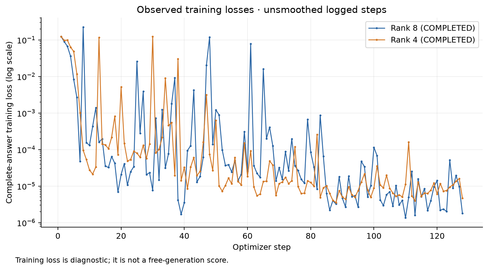
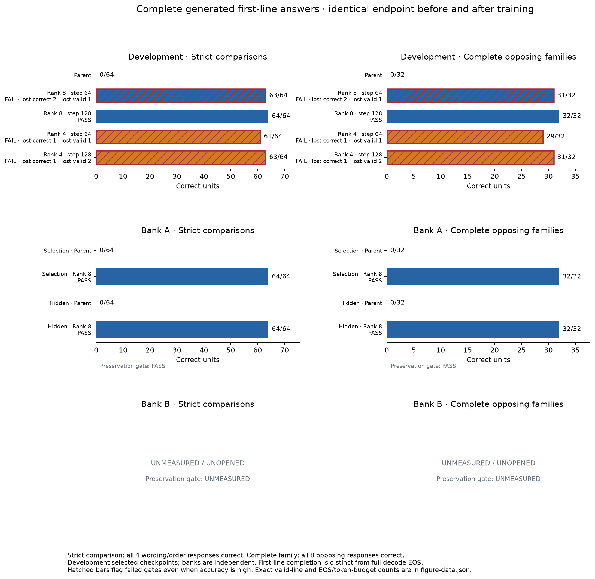

# Phase III-R: fresh replication and conditional rank reduction

**Rank-eight result: VERIFIED_REPLICATION_PASS.** Step 128 passes practice,
development, Bank A preservation, independent selection and sealed verification
as an exact merged BF16 checkpoint. Independent reconstruction, complete-output
replay and original-checkpoint rollback pass. Step 64 remains rejected. The
conditional rank-four run ends in **TRANSFER_WITH_PRESERVATION_FAILURE**:
both checkpoints improve development answers but fail its zero-regression and
valid-output requirements. Rank four has no finalist; merging and Bank B remain
unopened and unmeasured.

This isolated study starts at `d0e0ea9e4cc1687d5ed0a70a321ca0af66b24c8a`.
It preserves the successful [Phase III-Q baseline](PHASE_III_Q_BASELINE.md),
its original checkpoint and historical evidence. Main, accepted lineage and
deployed models remain unchanged.

## Questions and declared scope

First, can the successful rank-eight recipe qualify again on fresh semantic
families at the same initialization seed? Only after exact independent
qualification does one rank-four run test retention of the rank-eight result.
This is a comparison of two declared adaptation configurations. It is not a
multiple-seed robustness study, a new optimizer, or a column search.

Both arms start from the original Qwen checkpoint
`7d4532858cf839d05ec34da088114df47238322f86f5e6e5c6693594a21a03b8`.
The attached directive omitted two characters from this hash; its 62-character
literal is not a SHA-256. A new read-only audit verified the existing original
directory against the valid Phase III-Q identity. No replacement was used.
The preserved Q merged reference is
`ddf9d6c72eab4cc6cbd7448a5d9c73a429881a26c721ef5726709df7ddf08191`.
Neither arm starts from it.

## Frozen design

The [protocol](../experiments/phase_iiir_replication/protocol.json) fixes the
two configurations, all populations, endpoint, budgets and gates before
training. The same 186 supported text linear modules across 24 layers receive
FP32 adapters while original BF16 parameters remain frozen. Rank eight has
alpha 16 and 5,411,328 trainable parameters; rank four has alpha 8 and
2,705,664. Both use the original randomized-A, zero-B initialization convention.
An independent data-order generator controls identical exposure despite
shape-dependent adapter initialization.

The shared population has 128 target truth-flipping families, 1,024 target
presentations and 1,024 equally weighted replay presentations. Development
has 32 fresh families. Each family retains both opposing outcomes, both operand
orders and both wordings. Exact Decimal arithmetic validates every label.
Host-side historical exclusion checks keep protected data private.

Bank A contains 32 selection families, 32 sealed families and 320 controls
for rank-eight replication. Disjoint Bank B has the same sizes and compares
the unchanged parent and both locked merged finalists. Its evaluation is
unavailable until both finalists pass the declared development checks.

AdamW uses learning rate 3e-4, betas (0.9, 0.999), epsilon 1e-8, weight decay
0.01, dropout zero, clipping 1.0, effective batch 16 through microbatches of
four, one epoch, 128 optimizer steps and seed 606117. The existing schedule
has seven warmup steps then linear decay over the 128-step horizon. Only steps
64 and 128 are evaluated. Supervision includes one leading space, the entire
canonical correct answer and newline; prompt and padding positions are masked.
The next-token causal shift and token-normalized loss are unchanged.

Each arm has one main attempt bounded by 5,400 wall seconds, 30,000 observed
process-tree CPU seconds, 24 GiB memory, 40,000 answer-token exposures and
400,000 input-token exposures. One disposable smoke per rank is limited to
32 optimizer steps. Exact interrupted training continuation is not validated;
an interrupted run cannot provide an eligible checkpoint or be silently
replaced. Temporary Windows sleep prevention is released after each run.

## Behavioral acceptance and persistence

All evaluations use native-tokenizer bare prompts, unrestricted greedy
generation, batch eight, six CPU threads, 128 input tokens and sixteen output
tokens. The frozen parser scores the completed first answer line. A valid
first line does not mean the full decode reached EOS. Full-continuation
differences and termination reasons are reported separately.

Practice must correct a repeatable error and gain a strict comparison.
Development must gain a strict comparison and a complete opposing family.
Every gate prohibits loss of required parent-correct or parent-valid responses.
Finalist ranking prefers family gain, strict gain, earlier step, then smaller
stored norm. A selected adapter must survive fresh loading, separate BF16
merging and remeasurement before independent evaluation.

Bank A runs preservation, selection, then sealed verification. Selection
requires positive strict gain; sealed verification requires at least two
strict gains and one complete-family gain. Exact reconstruction, independent
output replay and original-checkpoint rollback are also required. Only this
verified result permits rank-four main training.

Before Bank B opens, the selected rank-four checkpoint must retain all
rank-eight-correct and required valid development answers, controls, strict
comparisons and complete families. Bank B reports ordinary adaptation and
paired retention separately. Any applicable preservation or selection failure
stops access to the sealed stage. Neither result authorizes deployment or
automatic lineage admission.

## Implementation and validation

Phase III-R reuses the Q LoRA backend, completion loss, resource monitor,
generation endpoint, scoring, BF16 merge and independent verifier. Its additions
are versioned study bindings, fresh shared data, confirmation-bank isolation,
rank-specific authorizations and paired retention reporting. Historical Q
source and protocols remain unchanged. No new optimizer or learned controller
was introduced. Original runtime packages were reused without installation.

The prospective protocol SHA-256 is
`112fe555cad092d3dc89b42eff188fc865f8830ca01776ad6e611e7f8116cdfd`.
Preregistration commit `f642244` froze the study; commit `1f74bba` preserves
source and evidence byte identity on checkout. The rank-eight arm protocol is
`aa23f28c15fddc9978674c2a40892664b7116f91f5f07ea4651c51953dfc99b0`.

Host-only freshness checking verified all seven original Q roster hashes
against published commitments, then scanned the explicitly enumerated private
H-through-P archive trees and inherited disclosed sources. It excluded 2,152
numeric task identities and 538 negative-family anchor values. Numeric-equivalent
operands, reversed operands and counterfactual relatives remain grouped. The
claim covers the recorded JSON sources and recognized task identities; it does
not assert access to unlisted or unavailable historical private data. Raw
protected rosters and per-row outputs remain outside this repository.

The frozen runtime suite recorded **889 passed and two dependency skips**
(Matplotlib and MCP). The separate optional MCP suite recorded **23 passed**.
Earlier test receipts preserve three missing-import failures during concurrent
implementation and a later missing verifier-fixture receipt; those were fixed
before source freeze and model execution. Software passes establish the
implementation boundary, not successful behavioral qualification.

Receipts: [runtime validation](../results/phase-iii-r-replication/tests/frozen-v1/runtime.xml),
[optional MCP validation](../results/phase-iii-r-replication/tests/pre-freeze/mcp.xml),
and [read-only training summary](../results/phase-iii-r-replication/training-summary-v1.json).
The write-once [outcome manifest](../results/phase-iii-r-replication/outcome-v1/export-manifest.json)
binds the published receipts and derived [arm summary](../results/phase-iii-r-replication/outcome-v1/arm-summary.json)
and [compute accounting](../results/phase-iii-r-replication/outcome-v1/compute-accounting.json).
The [figure data](../results/phase-iii-r-replication/figures-v1/figure-data.json)
records every plotted value and its source identity. Raw protected-bank questions,
answers and per-row predictions are not published.

## Completed rank-eight training

The disposable four-family smoke achieved 32/32 completed correct responses,
eight new strict comparisons and four complete opposing families. Its matched
completion loss fell to 0.001349 of the initial value. Zero initialization,
fresh saved-adapter replay and disabling the adapter all passed their exact
prediction checks. All 372 factor tensors changed. This smoke fitted its own
training examples; it is not independent transfer evidence. The main run reset
all adapter, optimizer and random state.

Main training completed one epoch and all 128 optimizer steps: 2,048 example
exposures, 17,308 supervised answer tokens, 172,678 unpadded input tokens, and
512 forward plus 512 backward calls. All 372 factor tensors received nonzero
gradients and changed; 5,411,215 of their 5,411,328 entries changed. The exact
data order and every logged learning-rate value match the frozen schedule.
The first minibatch loss was 0.124429 and the last was 0.000001813. These losses
refer to different minibatches and are diagnostic observations, not a matched
accuracy or full-population loss comparison.

Both saved adapter files are 21,750,832 bytes. Their recorded hashes were
independently recomputed. The base remains the original pinned checkpoint;
training receipts affirm frozen base parameters and unchanged checkpoint bytes.

| Saved checkpoint | Effective unrounded norm | BF16 merge preview norm | Preview changed BF16 entries | Rounding residual norm |
|---|---:|---:|---:|---:|
| Step 64 | 3.997341692 | 4.028752127 | 428,408,668 | 0.517540864 |
| Step 128 | 4.126247258 | 4.156839644 | 430,288,456 | 0.517903821 |

These are measured previews from the saved factors across 186 affine matrices.
The step-128 preview was subsequently confirmed by actual BF16 merging and
independent evaluation; step 64 was not an eligible merged finalist. Step 64 adapter
SHA-256 is `9fd922a6c692db372fa69e310f235321b462fe827e166486874e506f3ff3aefd`;
step 128 is `798ed00453e94e20e6dcd69a9899ff9d6acd3d9b584a4494822c444d500ad0c4`.

The enclosing training monitor measured 3,123.877 wall seconds and 19,433.969
CPU seconds, comprising 18,201.375 observed worker-tree CPU seconds and
1,232.594 monitor CPU seconds. All main and subsequent action resource gates
passed; temporary sleep prevention was released after each action.

| Completed rank-eight scope | Wall seconds | Observed CPU seconds | Conservative process-tree peak bytes |
|---|---:|---:|---:|
| Disposable smoke | 518.820 | 2,680.172 | 7,038,115,840 |
| Main training | 3,123.877 | 19,433.969 | 7,291,002,880 |
| Fixed-checkpoint assessment | 1,090.649 | 6,408.703 | 15,731,875,840 |
| Adapter replay, merge and Bank A qualification | 1,518.499 | 8,927.250 | 25,673,211,904 |
| Independent reconstruction, replay and rollback | 1,048.421 | 6,486.797 | 17,925,668,864 |

These are separate enclosing scopes; their nested worker times are not added
again. The peak is the sum of observed per-process peaks, not a measurement of
simultaneous aggregate memory. The largest observed scope remains within the
frozen 24 GiB cap. Software validation, initial resource preflight and reporting
costs are outside this table.
Polling cannot rule out unobserved short-lived process cost; CPU is reported
with its observation scope rather than asserted as exact total machine usage.

## Results and interpretation

Both preregistered checkpoints have completed practice and development
assessment. Step 128 passes both endpoints without lost correct or valid
responses. The frozen ranking locks `run-0-step-0128`, the only eligible
checkpoint. These first measurements use the unmerged adapter. Its exact merged
BF16 representation subsequently passed both endpoints and the independent
Bank A gates below.

| Endpoint | Original parent | Rank-eight step 64 | Rank-eight step 128 |
|---|---:|---:|---:|
| Practice target answers | 13/128 | 127/128 | 128/128 |
| Practice strict comparisons | 0/32 | 31/32 | 32/32 |
| Practice complete opposing families | 0/16 | 15/16 | 16/16 |
| Development target answers | 35/256 | 255/256 | 256/256 |
| Development strict comparisons | 0/64 | 63/64 | 64/64 |
| Development complete opposing families | 0/32 | 31/32 | 32/32 |
| Shared control presentations | 80/80 | 78/80 | 80/80 |
| Practice valid completed first lines | 208/208 | 207/208 | 208/208 |
| Development valid completed first lines | 336/336 | 335/336 | 336/336 |
| Practice and development gate | Reference | FAIL | PASS |

The large target gains do not override preservation. At step 64, both wordings of one
addition control, `19 + 56`, change from the correct `75` to `65`. The same
control probe is deliberately reused in practice and development, so these
are two affected presentations of one control, not independent evidence of
four harms. Copying, successor, mixed-sign and positive-comparison controls
remain 16/16 in each measured group. This is a specific measured preservation
failure; it does not establish broad loss of arithmetic ability.

At step 64, one negative-far response in each population also loses valid output status:
the practice answer `-5881.6478` becomes `-5881.6`, and the development answer
`-4671.8404` becomes `-4671.84`. Those outputs do not match a displayed option
under the frozen exact task semantics. Valid completed lines fall from 208/208
to 207/208 in practice and from 336/336 to 335/336 in development. All reported
full greedy decodes reach the sixteen-token budget, with zero EOS stops.

Step 64 corrects twenty repeatably wrong practice comparisons and thirty-four
repeatably wrong development comparisons, but is ineligible because the
zero-regression and valid-output requirements fail. No thresholds, dataset
weights or training steps have been changed in response. The prospectively
scheduled step-128 checkpoint recovers those lost controls and valid outputs;
the study did not add optimization steps or select a different recipe after
observing the step-64 failure.

## Verified rank-eight replication

The locked adapter reloaded in a fresh process. Its separate merged BF16
checkpoint has SHA-256
`2d9102982dc0f0fdf3397308cd397bc2d5239eeb99ef6297e5f09f6f6deba158`,
actual update norm **4.156839644102188** and **430,288,456 changed BF16 entries**.
The update affects 186 adapted matrices. Relative to their combined original
norm of 315.25779977949935, its norm ratio is 0.013185525138504439. Relative
to the full original model norm of 931.3206258073, the ratio is
0.004463381921235484. These are distinct denominator scopes; neither is a
fraction of trainable parameters or a measure of behavioral change.
The merged checkpoint retained all 208 practice and all 336 development answers,
including 32/32 and 64/64 strict comparisons and 16/16 and 32/32 complete
opposing families, respectively.

The adapter and merged model are not identical generation processes. Their
generated token sequences differ on 24/208 practice presentations and 17/336
development presentations. Their first answer lines do not differ in either
population, and both satisfy the frozen complete-first-line endpoint. This
separates measured endpoint preservation from equality of all continuation tokens.

Only that locked merged artifact entered the prospectively frozen Bank A gates.
No later outcome changed training, checkpoint selection, prompts or decoding.

| Bank A endpoint | Original parent | Locked merged rank eight | Prohibited losses |
|---|---:|---:|---:|
| Preservation-validation responses | 320/320 | 320/320 | 0 |
| Independent-selection target responses | 34/256 | 256/256 | 0 |
| Independent-selection strict comparisons | 0/64 | 64/64 | 0 |
| Independent-selection complete opposing families | 0/32 | 32/32 | 0 |
| Sealed target responses | 37/256 | 256/256 | 0 |
| Sealed strict comparisons | 0/64 | 64/64 | 0 |
| Sealed complete opposing families | 0/32 | 32/32 | 0 |

The independent verifier reconstructed the exact candidate, replayed all 832
candidate predictions, restored the original checkpoint, and replayed all 832
parent predictions. Exact identities, output replay and rollback passed. The
private final-verification receipt has SHA-256
`f4cdf7d231e80469f2a688715bed67ec45cd87b0ea98f5b2b5010678d2504edf`.
The enclosing verifier resource gate and the independent replication-admission
check both passed. The resulting status is **VERIFIED_REPLICATION_PASS**.

This is a fresh-family replication of the previously successful training recipe
at one preregistered seed. It demonstrates complete opposing-family transfer
and preservation on the declared suites for this checkpoint and endpoint.
It does not establish every Qwen capability, multiple-seed robustness, general
numeric reasoning, or an advantage for the historical direct-edit solvers.
Full-line correctness remains distinct from full-decode EOS termination.

The verified receipt permitted the conditional rank-four experiment. That run
completed training but failed development qualification, so its merged-artifact
behavior and the paired Bank B retention comparison remain unmeasured. This
reduction failure does not erase the verified replication or prove that every
smaller solution is impossible. Neither arm authorizes deployment or automatic
accepted-lineage modification.

## Completed rank-four training

The conditional rank-four main run used the unchanged original checkpoint and
the prospectively frozen rank-four configuration. It completed all 128 steps,
2,048 example exposures, 17,308 answer tokens, 172,678 unpadded input tokens,
and 512 forward plus 512 backward calls. Its data-order commitment is identical
to rank eight:
`a8ce00975c4117ceb924a3174eef969dd549a2416a0b41246291a3952061ca9d`.
The common data order does not imply identical initialization values in factors
of different shapes.

All 372 factor tensors received nonzero gradients and changed; 2,705,608 of
2,705,664 trainable entries changed. Frozen-base identity checks passed. The
first minibatch loss was 0.124429 and the final minibatch loss was 0.000004699.
As for rank eight, these are different minibatches and do not constitute an
independent behavioral result.

| Main-training measurement | Rank eight | Rank four |
|---|---:|---:|
| Trainable factor parameters | 5,411,328 | 2,705,664 |
| Saved adapter bytes per checkpoint | 21,750,832 | 10,927,792 |
| Optimizer steps | 128 | 128 |
| Forward / backward calls | 512 / 512 | 512 / 512 |
| Wall seconds | 3,123.877 | 3,106.709 |
| Observed CPU seconds | 19,433.969 | 19,431.594 |
| Conservative process-tree peak bytes | 7,291,002,880 | 7,211,921,408 |

Rank four halves the trainable parameter count and reduces the saved adapter
file size by 49.76%. Its measured main CPU time is effectively unchanged in
these single runs; the small wall-time difference does not establish a reliable
speed advantage. The separate rank-four smoke used 515.828 wall seconds,
2,654.422 observed CPU seconds and a 6,993,960,960-byte conservative peak.
Both smoke and main resource gates passed.

| Rank-four checkpoint | Effective unrounded norm | BF16 merge preview norm | Preview changed BF16 entries | Rounding residual norm |
|---|---:|---:|---:|---:|
| Step 64 | 3.078569366 | 3.116135004 | 408,587,695 | 0.511371309 |
| Step 128 | 3.105897194 | 3.143200987 | 409,100,536 | 0.511508070 |

These rank-four values remain saved-factor merge previews; they do not report
an evaluated merged checkpoint. Their ratios to the original adapted-matrix
norm are 0.009884402563794394 and 0.009970256053153666, respectively. Both
adapter-file hashes were recomputed: step 64 is
`c7e42ad1673fedda46ada5a42fa81c0511d2a5debf5bda60c89fede39f1ecdcc`;
step 128 is
`4d6e2fdb097caadc4ffb9a8fc8078520e446e5bf15f6ae9581aa97a7cb7722ba`.
There is no qualified rank-four reduction result: its development gate failed
before independent paired retention could be tested.

## Rank-four transfer and preservation failure

Both preregistered rank-four checkpoints passed practice with all 208 correct
and valid responses, 32/32 strict comparisons and 16/16 complete families.
Both also made large gains on the fresh development population. Neither
preserved every required parent-correct and parent-valid development response.

| Rank-four development endpoint | Original parent | Step 64 | Step 128 |
|---|---:|---:|---:|
| Target responses | 35/256 | 252/256 | 254/256 |
| All responses including controls | 115/336 | 332/336 | 334/336 |
| Strict comparisons | 0/64 | 61/64 | 63/64 |
| Complete opposing families | 0/32 | 29/32 | 31/32 |
| Control responses | 80/80 | 80/80 | 80/80 |
| Valid completed first lines | 336/336 | 335/336 | 334/336 |
| Previously correct presentations lost | Reference | 1 | 1 |
| Previously valid presentations lost | Reference | 1 | 2 |
| Development gate | Reference | FAIL | FAIL |

At step 64, the parent-correct regression is one wording of the negative-far
comparison `-6075.4` versus `-6071.8522`: the adapter selects the smaller
displayed value. A different negative-far answer is truncated from the required
`-5391.6649` to `-5391.6`, which is not one of the displayed options. At step
128, that truncation occurs under both wordings in one operand order, including
one presentation that the parent answered correctly. The other three
step-64 incorrect presentations have been corrected, but this repeated
out-of-option answer failure still violates the frozen gate. All five
control groups remain 16/16 at both checkpoints.

The failure is specific: fresh complete-family learning is present, but strict
preservation and valid-answer retention are not. It is not a pipeline failure,
absence of transfer, or measured failure on Bank B. All 336 full development
decodes per checkpoint finish at the sixteen-token limit, with zero EOS stops;
the reported correct first lines must not be read as EOS-complete generation.

The enclosing assessment completed normally with no execution errors, using
1,089.111 wall seconds, 6,369.750 observed CPU seconds and a conservative
15,716,814,848-byte process-tree peak. Its resource gates passed, while its
scientific result was `no_practice_and_development_qualified_adapter`.
No rank-four candidate was locked, merged or sent to preservation validation,
independent selection or hidden verification. No extra optimization steps,
changed parser or additional checkpoint search followed the failure.

Across the eight performed, nonoverlapping monitored model-workflow scopes,
recorded wall time sums to **12,011.914 seconds** and observed CPU time to
**72,392.656 seconds** (about 200.2 wall minutes and 20.1 CPU hours). These sums
include smoke tests, training, evaluation, merging, reconstruction and rollback
where performed. They exclude implementation time, software tests, initial
preflight and report production; unperformed rank-four stages remain null.
No paid compute or remote inference was used. Electricity was not measured.
[Compute accounting](../results/phase-iii-r-replication/outcome-v1/compute-accounting.json)





## Conclusion and next decision

The rank-eight baseline replicated on fresh semantic families and passed the
declared independent zero-regression contract after BF16 merging, reconstruction
and replay. This preserves a working reference for the narrow measured task.
The rank-four configuration halves trainable factor capacity and nearly halves
adapter-file size, but does not retain every required development behavior.
It is therefore not a qualified smaller replacement.

These are one-seed results for two prospectively selected configurations.
They do not estimate a universal minimum rank, compare all smaller models, or
prove that more optimization would fix the specific failures. Training used
the same data order and exposure, while the factor shapes and initialization
values differ; there was no attempt to isolate every possible rank-related
effect. Main training CPU cost remained nearly equal despite the parameter
reduction. Independent Bank B comparisons, rank-four merging, deployment and
continual learning remain untested.

Retain the verified rank-eight recipe as the reference. The next justified
experiment is a separately frozen rank-four replication with a fresh
initialization and new confirmation families, keeping this study's failed
outcomes visible. Any change to training duration, replay mixture or output
training must be declared as a new ablation rather than tuned against Bank A,
Bank B or the current development failures. No new custom optimizer is justified
by this result alone.

## Reproduction and access boundaries

Use the pinned original checkpoint and recorded local runtime; these commands
do not download a model. A new study initialization requires new write-once
private paths, the published architecture inventory, and the host-held historical
rosters for exclusion checking. The exact committed private confirmation sets
are not distributed. Replaying their scores requires the operator's matching
data and authorization receipts.

For an already initialized, unrun rank-eight arm, set `$wbPython`, `$wbBase`
and `$wbStudy` to the recorded interpreter, original model and private study
directory. The disposable smoke, main authorization and training commands are:

```powershell
& $wbPython -m experiments.phase_iiir_replication.smoke `
  --base $wbBase --protocol "$wbStudy/rank8/protocol.json" `
  --authorization "$wbStudy/rank8/smoke-authorization.json" `
  --bundle "$wbStudy/rank8/smoke-bundle.json" `
  --rows "$wbStudy/rank8/material/smoke.json" --out "$wbStudy/rank8/smoke"
& $wbPython -m experiments.phase_iiir_replication.initialize authorize-main `
  --out $wbStudy --arm rank8 --smoke-gate "$wbStudy/rank8/smoke/smoke-gate.json"
& $wbPython -m experiments.phase_iiir_replication.training `
  --base $wbBase --protocol "$wbStudy/rank8/protocol.json" `
  --authorization "$wbStudy/rank8/main-authorization.json" `
  --bundle "$wbStudy/rank8/training-bundle.json" --out "$wbStudy/rank8/training" `
  --smoke-gate "$wbStudy/rank8/smoke/smoke-gate.json"
& $wbPython -m experiments.phase_iiir_replication.execute assess `
  --base $wbBase --study $wbStudy --arm rank8
```

Each action has a write-once launch claim. A failed run must not be replaced by
changing its output directory. Only a passed assessment admits `execute qualify`;
only completed independent gates admit `execute verify`. Rank four additionally
requires the exact verified replication receipt. Neither an inner success nor
a public report can bypass an enclosing resource refusal or a behavioral gate.

Report-only export and plotting scripts live in
[`results/phase-iii-r-replication`](../results/phase-iii-r-replication/).
They do not participate in training or authorization. Figures consume only
public recorded measurements; missing stages are omitted or marked unmeasured.

From a checkout with the recorded runtime, replay the public artifact hashes,
complete-answer scores, gates and checkpoint ranking without loading a model:

```powershell
& $wbPython results/phase-iii-r-replication/verify_public.py `
  --public-export results/phase-iii-r-replication/outcome-v1 `
  --out "$env:TEMP/weightbridge-r-public-replay-new.json"
```

The output path must be new. Public replay is an archive check, not a fresh
model experiment or a replay of protected raw confirmation rows. The published
independent aggregates retain hashes of the host-private receipts. The
[recorded public replay](../results/phase-iii-r-replication/public-replay-v1.json)
checks 422 exported artifacts and 141 frozen scientific source files.
