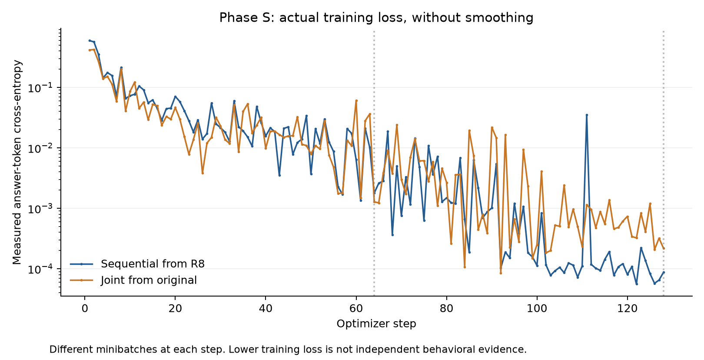
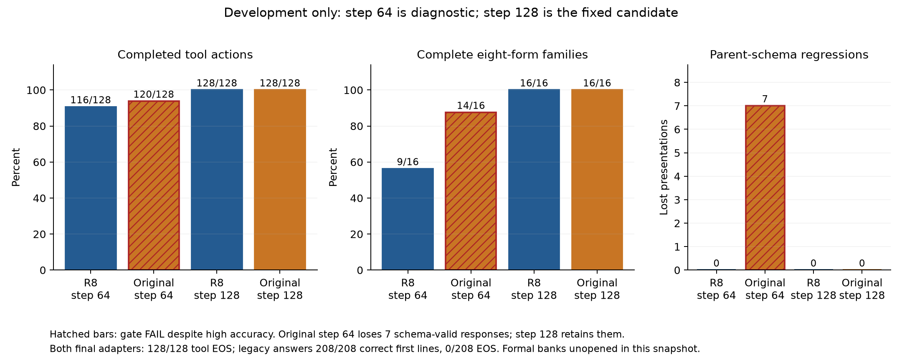

# Phase III-S: grounded tool transfer after a verified decimal improvement

**Execution milestone: formal populations, protocols and 162 source files remain
frozen. Both parent baselines, disposable smokes, main training runs and adapter
development evaluations have completed. Both fixed step-128 adapters passed
development: all 128 tool responses and 208 legacy responses were correct. The
sequential stored BF16 merge, exact reconstruction, native development replay
and actual-parent rollback also passed. The original-parent stored model scores
127/128 tool responses and 15/16 tool families after losing one adapter-learned
answer during BF16 merging; its frozen development and reconstruction gates
still pass. Both finalist decisions are locked. Both stored candidates score
832/832 on the historical R battery with no required parent-behavior loss.
Sequential fresh qualification has completed: 256/256 tool responses and all
32 families pass, but its formal gate fails for insufficient semantic improvement
headroom across two real-action types. All four measured qualification replays
pass. Original-parent qualification is in progress with no reported outcome;
both sealed confirmations remain unopened. No independently qualified Phase S
improvement is reported.** The
sequential and original-parent arms use the same new curriculum and fixed
rank-eight recipe. Formal gates remain strict.

This work starts from `baa336e7c517139876a1a5d6309af7199ea1e661` on an isolated
`dev/phase-iii-s-tool-transfer` branch. Main, original and R checkpoint bytes,
historical evidence, deployed models and accepted lineage remain unchanged.
It builds on the [verified Phase III-R replication](PHASE_III_R_REPLICATION.md),
not its rejected rank-four reduction.

The prospective scientific source commit is
`22ca0b3bf21500b811e61ca7088fe39404ca4738`. The frozen study manifest SHA-256 is
`ccc217d9139d214ecb241acb3099006a9cc35a0b3f85a6f49784adc3de9a813a`.
The sequential protocol is
`17907f42b9c32dba0446ec71244b58bb0cbcf2f3a8d303bd300c9f1bfb4256d9`;
the original-joint protocol is
`9642caa3e997cfee363f3192512aaf7bcafb4749342819414f6a182972cb9154`.
The [public preregistration](../results/phase-iii-s-tool-transfer/preregistration-v1/export-manifest.json)
records those original byte identities and separately hashed redacted projections.

## Question and comparison

Can a fresh adapter add grounded, single-action tool behavior to the verified
decimal model while retaining its measured decimal capability? The sequential
arm starts from the locked R8 merged checkpoint. The control starts from the
unchanged original model and receives the same tool examples and decimal replay;
it is **original-parent joint training**, not a tool-only control. The inherited
R training cost belongs to the sequential model's history and is separate from
the additional matched S training budget.

Both starting identities were recomputed through the existing checkpoint path:

| Starting representation | SHA-256 | Identity check |
|---|---|---|
| Original Qwen3.5-0.8B | `7d4532858cf839d05ec34da088114df47238322f86f5e6e5c6693594a21a03b8` | PASS |
| Verified R8 merged model | `2d9102982dc0f0fdf3397308cd397bc2d5239eeb99ef6297e5f09f6f6deba158` | PASS |

Both contain 488 checkpoint tensors. Their tokenizer, configuration and native
chat-template files match. The R acceptance receipt was validated against its
pinned historical checkout. Separately, public archive checking verified 422
published R artifacts and 141 frozen source files; that archive check did not
execute a model or replay private confirmation responses.

## Grounded single-action task

The versioned registry permits exactly five actions:

| Tool | Exact arguments | In-memory effect |
|---|---|---|
| `search_files` | `root`, `query` | Search fixture paths and content for the exact literal query |
| `read_file` | `path` | Return the selected readable fixture's content |
| `run_tests` | `target` | Return the selected test target's recorded result |
| `clarify` | `field` | Request the missing or ambiguous `root`, `path` or `target` |
| `no_action` | none | Decline an explicitly unsupported request, scope or file type |

No generated action executes a shell command or accesses a filesystem, network
or real repository. Each prompt supplies the registry, inventory, target mapping
and natural request. Close paths and targets are distractors. Wrong queries,
paths or targets are executed against their own fixture entries and do not
silently return the intended result.

The independent label checker uses visible request semantics and inventory
facts. Family IDs and scenario labels do not determine its answer. The separate
simulator does not compare an action to a stored gold label. Counterfactuals
change availability, required fields, support, or the requested operation; both
outcomes appear under two wordings and two inventory/registry orders. One family
therefore has eight presentations. This tests a narrow single-action decision,
not multistep planning or general software engineering.

The complete response must be one JSON object with exactly `tool` and
`arguments`. The parser rejects unknown fields or tools, duplicate keys,
wrong argument types, extra objects, prose and unexpected special tokens.
Ordinary surrounding whitespace is allowed. Full JSON syntax, registered-schema
validity, semantic correctness and natural completion are separate measurements.
Strict success requires all of them, including the correct simulated outcome.
There is no extraction, repair, reranking, forced brace, logit bias or oracle
routing during inference.

Tools use the pinned native non-thinking chat template and greedy decoding,
six CPU threads, batch eight, a 512-token input ceiling and 96-token output
budget. Only the declared native terminator, `<|im_end|>` with ID 248046, is
removed as transport. Its occurrence is required for strict success. Legacy
decimal and general controls retain the existing bare-prompt, sixteen-token,
completed-first-line evaluator. A valid decimal first line is not an EOS stop.

## Measured disposable calibration

Calibration was committed before its first model output: ten independent tool
families, 80 presentations and exactly sixteen examples of each action. Its
family identities and wording templates are excluded from formal populations.
A single fixed JSON format example comes from this disposable population and
is identical in both models' prompts. Native tool prompts ranged from 257 to
402 tokens; the longest supplied answer including terminator used 27 tokens.
The separate legacy screen contains 32 negative-decimal target presentations
and forty positive, mixed-sign, copying, addition and successor controls.

| Disposable tool endpoint | Original parent | Verified R8 parent |
|---|---:|---:|
| Whole-response JSON syntax valid | 71/80 | 17/80 |
| Registered schema valid | 54/80 | 17/80 |
| Correct tool and exact arguments | 16/80 | 6/80 |
| Correct simulated outcome | 16/80 | 6/80 |
| Strict completed actions | 16/80 | 6/80 |
| Complete eight-presentation families | 0/10 | 0/10 |
| Natural EOS termination | 80/80 | 17/80 |
| Output budget reached | 0/80 | 63/80 |

All successful tool actions in this screen are reads. The original model has
38 schema-valid semantic errors across ten families, including erroneous
search and test decisions. The R8 parent has eleven such errors across four
families, with search as its only represented real-action error type. It also
has extensive completion failure. Thus the R8 deficiency cannot be described
solely as an already qualified semantic-choice problem.

The conservative calibration plausibility screen passes for the original and
fails for R8: R8 misses the 50% schema-validity condition and the requirement
for semantic errors in two real action types. At least one parent provides
useful headroom, so the directive's overall no-headroom stop does not apply.
This does not grant R8 a semantic pass or relax its subsequent formal gains,
action-diversity, completion or retention gates. A formal bank without sufficient
qualifying opportunities must produce an insufficiency result, not a redraw.

Compared presentation by presentation, original-to-R8 tool behavior loses ten
strict and semantic successes, gains none, loses 39 schema-valid responses and
gains two. Those were not measured by the earlier decimal qualification. This
underscores the declared scope of preservation claims rather than revising R's
historical result.

| Disposable legacy endpoint | Original parent | Verified R8 parent |
|---|---:|---:|
| Negative-decimal target responses | 4/32 | 32/32 |
| Strict comparisons | 0/8 | 8/8 |
| Complete opposing families | 0/4 | 4/4 |
| General/positive controls | 40/40 | 40/40 |
| Valid completed first lines | 72/72 | 72/72 |
| Full decode reached EOS | 0/72 | 0/72 |

These are fresh disposable measurements of unchanged parents, not a Phase S
learning result, independent confirmation or a population-level competence claim.

## Parent development and disposable pipeline check

Both immutable parents have now completed the frozen development population.
These measurements were made before candidate development evaluation and do
not change either arm's recipe or admission rules. All 128 tool presentations
use independently authored wording absent from training.

| Development endpoint | Original parent | Verified R8 parent |
|---|---:|---:|
| Whole-response JSON syntax valid | 113/128 | 65/128 |
| Registered schema valid | 99/128 | 45/128 |
| Correct tool and exact arguments | 24/128 | 23/128 |
| Strict completed actions | 24/128 | 23/128 |
| Complete eight-presentation tool families | 0/16 | 0/16 |
| Natural tool EOS termination | 128/128 | 65/128 |
| Tool output budget reached | 0/128 | 63/128 |
| Negative-decimal correct responses | 19/128 | 128/128 |
| Strict decimal comparisons | 0/32 | 32/32 |
| Complete opposing decimal families | 0/16 | 16/16 |
| General control correct responses | 80/80 | 80/80 |
| Valid completed legacy first lines | 208/208 | 208/208 |
| Full legacy decode reached EOS | 0/208 | 0/208 |

All strict tool successes remain reads. The original has 75 schema-valid
semantic errors across fifteen families, including search and tests. R8 has
22 across seven families, but search is again its only represented real-action
error type. This preserves the calibration warning: better formatting alone
would not meet the separately frozen semantic correction requirement. The
formal banks must supply their own headroom evidence; they cannot be redrawn
if that evidence is insufficient.

Original-to-R8 development tool behavior loses one strict/semantic success,
54 schema-valid responses and 63 natural completions, with no gains in those
three measures. The paired-family 95% percentile interval for strict accuracy
change is [-2.34375, 0] percentage points, from 2,000 resamples of sixteen
families. This small, conditional sample does not justify a population-wide
harm estimate. A later recovery of the lost original success must be reported
separately from correcting behavior the original model never solved.

The parent audit's private byte commitment is
`e9b3e7bf81b7884c94c4a6041708013823ac23854b7908c9b34f00cc58108887`.
The report exporter retains its aggregate projection and source commitment,
without publishing per-row outputs. Its four disjoint enclosing workers used
848.334 wall seconds, 4,996.563 observed CPU seconds and a maximum conservative
peak of 3,020,677,120 bytes.

The sequential disposable smoke passed all eleven pipeline checks: exact
zero-adapter behavior, exact parent restoration after disabling the adapter,
finite learning, changed factors, nonzero gradients, unchanged base and saved
adapter reload. Its matched supervised-token loss fell from 0.5974557452 to
0.0460563386. Sixteen optimizer steps made 64 forward and 64 backward calls,
with 256 example visits, 4,154 answer tokens and 72,346 input tokens. Every one
of the 372 factors changed and received a nonzero gradient. This is a disposable
training-pipeline result, not independent skill or preservation evidence.

The smoke gate commitment is
`0ee29d2cbe8954e58b1f4ebf5dbaf1b64df8ea3d4886a53b602aee4372cf430e`;
its training completion commitment is
`41f07b90dc6f6e780751370c3dc71cb2f7ba98934ec4a1e4a9c76eec7a032611`.
The three enclosing smoke workers together used 2,343.973 wall seconds and
14,239.828 CPU seconds, with maximum conservative peak 14,951,276,544 bytes.
Those totals include zero-state generation and fresh reload; the nested
training-worker costs must not be added again. Main training starts with fresh
factors, optimizer, schedule and random state rather than these learned factors.

| Candidate stage | Sequential arm | Original-parent joint arm |
|---|---|---|
| Main training | COMPLETED | COMPLETED |
| Step-64 diagnostic development | PASS, diagnostic only | FAIL: seven schema regressions |
| Fixed step-128 development | DEVELOPMENT_QUALIFIED | DEVELOPMENT_QUALIFIED |
| Merged development and exact reconstruction | PASS | PASS; one adapter-to-merge loss |
| Old R locked battery | PASS: 832/832 retained | PASS: 832/832; zero own-parent losses |
| Independent qualification | FAIL: insufficient two-action semantic headroom; four exact replays PASS | IN PROGRESS; outcome unmeasured |
| Sealed confirmation and exact replay | UNOPENED | UNOPENED |

These statuses describe this reporting milestone. Missing observations are not
zeros or passes, and no training-loss change fills an unmeasured behavioral cell.

## Sequential adapter development result

The one authorized sequential run completed all 128 optimizer steps: 512
forward calls, 512 backward calls, 2,048 example visits, 28,932 supervised tokens,
471,134 unpadded input tokens and 757,236 padded input positions. All 372 factor
tensors changed and received nonzero gradients. The frozen parent remained
unchanged. The first and final optimizer-batch losses were 0.5950803449 and
0.0000876359; these are different minibatches, not a matched held-out loss
comparison. Every recorded step is retained in the public snapshot.

| Development measurement | R8 parent | Sequential adapter, step 64 | Sequential adapter, step 128 |
|---|---:|---:|---:|
| Strict completed tool actions | 23/128 | 116/128 | 128/128 |
| Correct tool identity | 23/128 | 118/128 | 128/128 |
| Correct exact arguments and simulated result | 23/128 | 116/128 | 128/128 |
| Schema-valid responses | 45/128 | 128/128 | 128/128 |
| Complete eight-presentation tool families | 0/16 | 9/16 | 16/16 |
| Natural tool EOS termination | 65/128 | 128/128 | 128/128 |
| Previously correct/semantic tool responses lost | — | 0 | 0 |
| Previously schema-valid tool responses lost | — | 0 | 0 |
| Negative-decimal correct responses | 128/128 | 128/128 | 128/128 |
| Strict decimal comparisons / complete families | 32/32; 16/16 | 32/32; 16/16 | 32/32; 16/16 |
| General controls correct | 80/80 | 80/80 | 80/80 |
| Valid completed legacy first lines | 208/208 | 208/208 | 208/208 |
| Legacy decode reached EOS | 0/208 | 0/208 | 0/208 |

All legacy decodes reached their sixteen-token budget, despite correct completed
first lines. All 128 development tool prompts use wording absent from training.
Step 64 passes the applicable development gate but remains diagnostic. The
precommitted sole candidate is step 128; no checkpoint search selected it.

The final adapter recovered one original-model tool success that R had lost
and corrected 104 responses the original model answered incorrectly. These
are separate from the 105 gains over its actual R8 parent. It corrected all
22 parent-schema-valid semantic errors across seven families. However, only
`search_files` is represented among qualifying real-action corrections; other
corrections in this subset are clarify/no-action. Thus the development result
does not itself establish the formal two-real-action requirement. Formal
headroom and qualification remain separately gated, with no redraw or relaxation.

All 109 original-wrong/R8-correct decimal responses and all sixteen newly
completed R decimal families on this fresh development population survived.
Preservation in this adapter-only snapshot is limited to those measured
populations. The historical R battery and independent banks were then unopened;
later historical retention evidence is reported separately below.

Relative to R8, the final development strict-action gain is 82.03125 percentage
points, with paired-family 95% bootstrap interval [69.53125, 93.75]. Complete
family gain is 16/16; the empirical family-rate interval is [1, 1] because every
observed family improved. That degenerate finite-sample interval is not a claim
of certainty on new tasks, wordings or models. Development supplied the gate;
it is not independent confirmation.

The adapter artifacts each occupy 21,750,848 bytes and contain 5,411,328
trainable values. Step-64 SHA-256 is
`84f9cc671a2924eec55e1b1af724bff9e86fca154351858f009c8e44f07a0f22`;
the fixed step-128 SHA-256 is
`610b482e070552d3fec75140f6e3a3ca724caaa7ebb994666322a5ad3c8205ee`.
These identify saved adapters, not merged checkpoints.

| Numerical diagnostic | Step 64 | Step 128 |
|---|---:|---:|
| Unrounded effective update norm | 3.5147371891 | 3.6446136515 |
| Previewed BF16 merged-delta norm | 3.5492954578 | 3.6782808892 |
| Previewed changed BF16 entries | 418,443,658 | 420,829,239 |
| Previewed rounding residual norm | 0.5152060731 | 0.5157644719 |
| Previewed relative norm on adapted matrices | 0.0112574514 | 0.0116665600 |

These are numerical merge previews computed from the trained factors. They do
not establish a materialized merged checkpoint or identical BF16 generations.
The relative denominator is the full adapted attention/MLP matrices, whose
parent norm is 315.2841010366, rather than the entire model. The subsequent
stored-checkpoint measurements below now test these previews directly.

Observed supervision matches the frozen exposure. Of 28,932 total supervised
tokens, tools supply 20,208 (69.8465%), negative decimals 4,824 (16.6736%), and
general replay 3,900 (13.4799%), despite a 50/25/25 row mixture. These are global
token-exposure fractions. The loss is normalized separately within every
effective batch. Averaging those 128 per-step objective coefficients instead
gives 68.6525% tools, 17.3030% negative decimals and 14.0445% general replay.
The two quantities differ because batches have different lengths and mixtures;
neither is an attribution of parameter-gradient influence. Both are computed
from the same observed step logs, without post-result reweighting.

| Additional enclosing model work | Wall seconds | Observed CPU seconds | Conservative peak bytes |
|---|---:|---:|---:|
| Sequential main training | 9,122.746 | 56,672.906 | 16,580,399,104 |
| Four adapter development workers | 830.063 | 4,638.672 | 3,072,778,240 |
| All recorded S scopes through this snapshot | 13,744.790 | 83,843.516 | 16,580,399,104 |

The last row includes calibration, timing, both parent baselines, disposable
smoke, sequential main and development. It excludes software tests and report
generation. Inner-worker measurements are included in their enclosing scopes,
not added again. The inherited R main cost, 3,123.877 wall and 19,433.969 CPU
seconds, is separate from this additional S total.

The write-once [sequential development snapshot](../results/phase-iii-s-tool-transfer/sequential-development-v1/export-manifest.json)
contains 15 hash-verified aggregate artifacts, including all training-step
records, both full projected development gates, the untouched-parent summaries,
factor identities and non-nested cost. Its optional top-level assessment-summary
field is null because that version looked at a different metadata location;
both actual step gates and their source commitments are present. Numerical
preview tensor hashes are retained, with tensor names supplied by the separate
inventory. These report-only omissions are corrected for subsequent exports;
this snapshot is preserved unchanged. Its merged-model and independent fields
remain null because those measurements had not occurred at that snapshot.
Original-parent joint training had not started then.

## Original-parent adapter development and matched comparison

The original-parent run completed the same 128 steps, 512 forward and backward
calls, 2,048 example visits, 28,932 answer tokens, 471,134 input tokens and
757,236 padded positions. All 372 factors changed and received gradients; the
base remained frozen. Its first/final minibatch losses were 0.4171076373 and
0.0002170235. These different minibatches are diagnostics, not a fixed validation
loss comparison. The fresh initialization, example order and token exposures
match the sequential arm. All 186 adapted source-matrix hashes differ between
the parents, as expected from the prior R update; module names and shapes match.

| Development measurement | Original parent | Joint adapter, step 64 | Joint adapter, step 128 |
|---|---:|---:|---:|
| Strict completed tool actions | 24/128 | 120/128 | 128/128 |
| Correct tool identity / exact arguments / simulator | 24/128 | 120/128 | 128/128 |
| Whole-response JSON syntax valid | 113/128 | 128/128 | 128/128 |
| Schema-valid responses | 99/128 | 121/128 | 128/128 |
| Complete eight-presentation tool families | 0/16 | 14/16 | 16/16 |
| Tool EOS termination | 128/128 | 128/128 | 128/128 |
| Previously correct or semantic tool responses lost | — | 0 | 0 |
| Previously schema-valid responses lost | — | **7** | 0 |
| Negative-decimal correct responses | 19/128 | 128/128 | 128/128 |
| Strict decimal comparisons / complete families | 0/32; 0/16 | 32/32; 16/16 | 32/32; 16/16 |
| General controls correct | 80/80 | 80/80 | 80/80 |
| Valid completed legacy first lines | 208/208 | 208/208 | 208/208 |
| Legacy EOS termination | 0/208 | 0/208 | 0/208 |
| Development gate | Reference | **FAIL** | **PASS** |

At step 64, high correctness and syntactically valid JSON did not compensate
for seven previously schema-valid responses becoming invalid under the action
schema. That checkpoint failed the gate and was diagnostic only. Ordinary
training continued under the predeclared schedule. The fixed step-128 checkpoint
retained all required schema/semantic successes and passed. No alternative
checkpoint or new hyperparameter was selected using this recovery.

The final original-parent adapter corrected 104 previously incorrect strict
tool responses and 75 schema-valid semantic errors across fifteen families,
including both `run_tests` and `search_files`. Its own-parent strict-action gain
is 81.25 percentage points, with paired-family 95% bootstrap interval
[68.75, 93.75]. All sixteen families became complete; the empirical family-rate
interval [1, 1] has the same finite-sample limitation described above. These
are fresh development observations, not the independent or sealed tests.

Both arms reach the same final development endpoint scores. The sequential
arm's corrected schema-valid semantic subset contains only `search_files`
among real-action types, whereas the original-parent arm's includes two types.
That difference reflects distinct parent deficiencies. It does not waive the
formal headroom requirements or establish either arm's independent advantage.

Both original-parent adapter artifacts contain 5,411,328 trainable values and
occupy 21,750,848 bytes. Step-64 SHA-256 is
`bc81ad8bdbeed6415c72383d0bcf00af27a21a74bb8596f03229183d31ffcf62`;
step-128 SHA-256 is
`67c182798539249ce1bbb69f903c365eb19657a95fa3a70efdc23b6dcd9833e4`.

| Original-parent numerical preview | Step 64 | Step 128 |
|---|---:|---:|
| Unrounded effective norm | 3.5596374246 | 3.7688531464 |
| BF16 merged-delta norm | 3.5938456144 | 3.8015831587 |
| Changed BF16 entries | 419,115,205 | 422,789,713 |
| Rounding residual norm | 0.5154287970 | 0.5163171841 |
| Relative norm on full adapted matrices | 0.0113997040 | 0.0120586490 |

The reference adapted-matrix norm is 315.2577997795. These are factor-derived
previews. Original-parent merged generations and exact reconstruction are
reported separately below; they remain outside the immutable adapter snapshot.

| Completed original-parent model scope | Wall seconds | Observed CPU seconds | Conservative peak bytes |
|---|---:|---:|---:|
| Disposable smoke, three enclosing workers | 2,096.204 | 12,675.875 | 14,948,958,208 |
| Main training | 9,863.390 | 61,242.141 | 16,579,567,616 |
| Four adapter development workers | 820.102 | 4,591.547 | 3,081,162,752 |

The new [both-arm adapter snapshot](../results/phase-iii-s-tool-transfer/both-adapter-development-v1/export-manifest.json)
contains sixteen public aggregate artifacts. Its export commitment is
`3f84e6e46621f9abe50e6db00ea84d99387bfc2d7dea30536f0a0a6a0dc26ad9`.
It includes all 256 main training-step records and four development checkpoints,
plus the already closed sequential stored-development gate. Active original
postdevelopment records are deliberately deferred. Included completed scopes
sum to 27,970.742 wall seconds and 169,788.797 CPU seconds, with peak
16,580,399,104 bytes; these are a scoped subtotal, not complete final study cost.
The deferred cost and formal outcomes remain null. Earlier snapshots are unchanged.





In this chart, blue **R8** labels denote the Phase S sequential arm starting
from R8; orange **Original** labels denote the Phase S original-parent joint
arm. Both show newly trained Phase S adapters, not unmodified parents or
historical Phase R checkpoints.

The [figure manifest](../results/phase-iii-s-tool-transfer/development-figures-v1/manifest.json)
binds public input hashes, plotting source and Matplotlib 3.11.2. The same
directory contains SVGs and [raw curve data with sixteen-step summaries](../results/phase-iii-s-tool-transfer/development-figures-v1/curve-data.json).
Plots use actual unsmoothed losses and explicitly show the failed step-64 gate;
they contain no synthetic formal results. The existing plotting environment
required no new dependency or model execution.

## Sequential stored development and exact reconstruction

The isolated BF16 checkpoint now has identity
`ce2ddca3dfdf0438aef401a33200a03d08b95c1988ee5c131da59a4a95036838`.
It was merged from the actual immutable R8 parent and the fixed step-128
adapter, then independently reconstructed to the same checkpoint identity.
Stored development again reached 128/128 strict tool actions, 16/16 complete
tool families, 128/128 negative-decimal responses and 80/80 general controls,
with zero prohibited development losses. No independent bank supplied these
decisions.

| Measured stored change | R8 to S increment | Original to final S checkpoint |
|---|---:|---:|
| Changed stored entries | 420,829,239 | 448,916,686 |
| Changed weight tensors | 186 | 186 |
| Absolute stored norm | 3.6782808892 | 5.5501063556 |
| Reference norm | 315.2841010366 | 941.2584608475 |
| Relative stored norm | 0.0116665600 | 0.0058964743 |
| Reference scope | Full adapted attention/MLP matrices | All stored floating tensors |

The original-to-final comparison inspected 873,438,784 stored entries; the norm
denominator includes floating tensors only. It is not interchangeable with the
incremental adapted-matrix denominator. The actual merged delta matches its
preview; its rounding residual relative to the unrounded S update is
0.5157644719. The original and R8 checkpoint identities remain unchanged.

Recorded provenance binds the prior original-to-R8 BF16 merge and the new
R8-to-S BF16 merge. The fresh S reconstruction starts from that verified R8
checkpoint and reproduces the same final bytes. This preserves the two distinct
rounding stages; it does not sum two deltas and round once. The cumulative
original-to-S transformation is not described as one rank-eight adapter.

Adapter and merged execution must still be distinguished:

| Adapter versus merged development | Tools | Legacy decimal/general |
|---|---:|---:|
| Presentations | 128 | 208 |
| Identical endpoint correctness/validity/completion flags | 128 | 208 |
| Identical complete native token/text streams | 128 | 184 |
| Different complete native streams | 0 | 24 |
| Changed stop reasons | 0 | 0 |

Thus merged endpoint success does not mean every unrestricted continuation
matches the FP32 adapter. All legacy streams still reached the token budget;
all tools ended naturally. The 24 differing legacy continuations are preserved
as a numerical-execution distinction, not hidden by first-line accuracy.

By contrast, exact replay compares each representation with its **own** recorded
outputs. The reconstructed stored candidate reproduced all 336 of its merged
development streams exactly. A fresh process using the actual R8 parent
reproduced all 336 parent streams exactly. These four task/representation replay
checks cover 672 responses, including incorrect parent answers and their full
continuations. They verify persistence and rollback on development; they do not
establish generalization or replace later independent replay.

The closed postdevelopment audit passed all recorded identity, source,
reconstruction, physical-base and no-promotion checks. It binds eight enclosing
model workers, which used 1,446.256 wall seconds and 7,435.719 observed CPU
seconds, with maximum conservative process-tree peak 3,017,097,216 bytes.
These are additional postdevelopment scopes, not nested measurements to add a
second time. Scientific review and publication consumed no additional model
calls.

The new write-once [stored-development supplement](../results/phase-iii-s-tool-transfer/sequential-stored-development-v1/export-manifest.json)
contains ten redacted metadata artifacts: numerical merge receipts, reconstruction
and development gates, the adapter/merged diagnostic and the closed integrity
audit. Its adapter/merged input commitment is
`8c5ab55680af8c4ba300ad93115f905c9375c9486848b0ca56b55dce7620ef56`;
the closed-audit input commitment is
`8c07a2c43698fd9f7e6b9d112898d733a1e7fffe47f7b8a120751439321df100`.
The previous adapter-only snapshot is unchanged. No raw responses, private
rosters, model weights or adapter tensors are published in either snapshot.

The sequential disposition is **FINALIST_LOCKED_PENDING_INDEPENDENT**, not a
verified scientific pass. The formal requirement for qualifying semantic
corrections in two real action types is still unresolved. Original-parent
stored verification has also passed. Historical retention began after both
decisions locked and has since passed for both arms. Independent stages have
no reported outcome at this milestone.

## Original-parent stored development and the BF16 merge loss

The original-parent merged checkpoint is
`0a8ec938d0ebfaa4b77a4d244307978038ebaebcd0d8d8baa1fffbe8657bcc72`.
It scores **127/128** strict tool actions and **15/16** complete tool families,
compared with 128/128 and 16/16 for its FP32 adapter. One newly learned semantic
answer is lost during merging. All 128 responses remain schema-valid and reach
native EOS. This is a measured adapter-to-merge failure of equivalence, even
though the stored model still passes the frozen development gate against its
unchanged original parent, with zero prohibited parent-behavior losses. No
acceptance rule was changed to admit it.

| Stored development representation | Strict tool actions | Complete tool families | Schema-valid tools | Tool EOS | Negative decimals | General controls |
|---|---:|---:|---:|---:|---:|---:|
| Original parent | 24/128 | 0/16 | 99/128 | 128/128 | 19/128 | 80/80 |
| Verified R8 parent | 23/128 | 0/16 | 45/128 | 65/128 | 128/128 | 80/80 |
| Sequential S merged | 128/128 | 16/16 | 128/128 | 128/128 | 128/128 | 80/80 |
| Original-joint S merged | 127/128 | 15/16 | 128/128 | 128/128 | 128/128 | 80/80 |

The two final stored models retain 32/32 strict decimal comparisons and 16/16
complete decimal families. All 208 legacy first lines are valid and correct;
all full legacy decodes still reach the sixteen-token budget rather than EOS.
These are development measurements under the same endpoint, not independent
qualification or proof of general tool competence.

The original-joint merged change has norm **3.8015831587**, affects 422,789,713
stored entries in 186 matrices, and has rounding residual 0.5163171841 relative
to the unrounded adapter update. Relative to the full adapted matrices its norm
is 0.0120586490, with reference norm 315.2577997795. Relative to all original
stored floating tensors it is 0.0040388303, with reference norm 941.2584608475.
Unlike the sequential chain, the original-to-candidate change is this same
single training-and-merge intervention.

Adapter-versus-merged native equality holds for 127/128 tool streams and 189/208
legacy streams. The one tool difference changes semantic correctness and
removes one complete family. The nineteen legacy differences change full
continuations while preserving every recorded endpoint flag and stop reason.
The original-parent diagnostic commitment is
`f4b37a461b48b2e2b4217238cf4a789f97ad46bec0fbb0c199cfd4c92e4007a2`.
It must not be described as the same behavior as the FP32 adapter.

Separate fresh-process reconstruction reproduced the exact stored checkpoint
and all **336 of its own** development streams, including its remaining tool
error. Actual-parent rollback reproduced all **336 original-parent** streams.
These are exact self-replays, not equality to the adapter or gold answers.
The host exact-reconstruction gate commitment is
`2d349ad8d51f92230a217cfd3c4a4e0a0957a2e43a6a56b18120f4fa8ff31149`.
Its eight enclosing postdevelopment model workers used 1,242.328 wall seconds
and 6,148.500 CPU seconds, with peak 3,020,541,952 bytes. Host waiting time is
not added to those already enclosed model costs.

Both stored finalists are now **FINALIST_LOCKED_PENDING_INDEPENDENT**. Their
development evidence differs, and formal outcomes remain unmeasured. The
separate closed integrity audit passed all eighteen checks, including both arm
locks, 162 source identities, physical checkpoint bindings and exact native
replays. Its commitment is
`2f235afaf571ba3472850a0d42501148dc10fc09c555460423a1c89e0353075d`.
The write-once [original stored-development supplement](../results/phase-iii-s-tool-transfer/original-stored-development-v1/export-manifest.json)
contains ten redacted aggregate artifacts and has export commitment
`b6ba1ea985ed4c8bee8ff8bbccd0dd5f0a339a294cb08fb1b8f96d7d517b8783`.
Previous adapter and sequential snapshots are unchanged. This publication did
not open a protected bank or run a model.

## Sequential historical retention

The sequential stored candidate retained every required response on the locked
**832-presentation Phase R Bank A battery**. These previously disclosed examples
measure preservation, not fresh generalization. R Bank B was not accessed.

| Historical population | R8 parent correct | Sequential S correct | Prohibited losses | Valid completed first lines |
|---|---:|---:|---:|---:|
| R preservation validation | 320/320 | 320/320 | 0 | 320/320 |
| R independent selection, now historical | 256/256 | 256/256 | 0 | 256/256 |
| R hidden verification, now historical | 256/256 | 256/256 | 0 | 256/256 |

Both decimal target populations retain all 64 strict comparisons and 32 complete
families each. The preservation population also satisfies the original/R8
general-control union. Every decode reaches the token budget; valid first-line
completion is not being reported as EOS termination.

The rebuilt candidate reproduced its own 832 native responses exactly, and
actual-parent rollback reproduced its own 832 recorded responses. The three
populations therefore have six passing native replay checks. The nine enclosing
workers generated 2,496 responses in total and used **1,440.668 wall seconds**,
**8,331.313 CPU seconds**, and **2,601,758,720 bytes** conservative peak memory.
These worker scopes are counted once; enclosing host waiting time is not added.

Compute coverage is narrower than total end-to-end execution. The completed
protected-host receipt also records 1,795.217 wall seconds and 849.406 CPU
seconds. These are **nonadditive** with the model ledger: the same host process
performs monitoring, and 573.21875 of its CPU seconds are already included in
the ledger's 8,331.3125 CPU seconds. Subtracting that measured overlap gives
276.1875 additional timed host CPU seconds. Separately timed bridge processes
record 41.250 CPU seconds, and the later metadata audit records 0.40625 CPU
seconds. Bridge wall time is already inside the host's elapsed clock.

| Sequential historical compute scope | Wall seconds | CPU seconds | Accounting treatment |
|---|---:|---:|---|
| Nine model-worker scopes, including monitors | 1,440.668 | 8,331.313 | Primary disjoint model-work ledger |
| Enclosing timed protected-host scope | 1,795.217 | 849.406 | Nonadditive; overlaps workers and monitoring |
| Exclusive timed host CPU | — | 276.1875 | Derived by subtracting recorded monitor overlap |
| Separately timed bridge CPU | — | 41.250 | Measured partial process time |
| Later metadata audit | 0.411 | 0.40625 | Separate review; no model calls |
| Pre-clock/startup, post-clock and unmeasured child verification work | UNMEASURED | UNMEASURED | Must not be filled with zero |

The known CPU subtotal is 8,649.15625 seconds, but it is **incomplete**. The host
clock starts after initial context/prerequisite validation and excludes its
final serialization. Bridge process clocks do not cover all startup work or
the historical-release child source-check CPU. No authoritative full-command
timestamps supply those gaps, and filesystem modification times are not a CPU
measurement. Later formal-stage reports must keep model-ledger work, overlapping
host clocks and unmeasured overhead separate in the same way. These reporting
limits do not retroactively change the frozen resource authorization.

The completed gate commitment is
`90af42866306f98edcf85f742f0b1618ba68de36bf2740a48b7eb10365fde3e5`;
the closed transaction is
`bf05c10b21bc9a5be32f16044189223c2efe97aeb01bf023cabc68d0818826b8`.
A separate metadata review passed 21 checks with commitment
`09fa648d9337486310d8b19d28f47b471427399d7b81c163c9f48216ec5ab78a`.
That review rechecked receipt bindings, closure, resources and aggregate
consistency without reopening raw responses or rosters. Behavioral correctness
and exact native equality were computed by the bound model workers and host
bridge, not recreated by the publication script.

The six-artifact [historical retention supplement](../results/phase-iii-s-tool-transfer/sequential-historical-retention-v1/export-manifest.json)
has export commitment
`083dc650b9ce0389074c1997e86034adcfda8cf57617dbf65515144af0510351`.
It contains only explicitly selected closed metadata and source commitments;
training logs and then-active original-parent stages were not re-exported. Fresh
qualification/confirmation outcomes remain null in this supplement. This
retention PASS is not an independent Phase S learning
or continual-learning qualification.

## Original-parent historical comparison

The original-joint stored candidate also scores **832/832** on the old R battery.
Its required comparator is its **own unchanged original parent**, not R8. The
following improvements are on a previously disclosed historical population and
must not be counted as fresh independent Phase S transfer.

| Historical population | Original parent correct | Original-joint S correct | Prohibited own-parent losses | Valid completed first lines |
|---|---:|---:|---:|---:|
| R preservation validation | 320/320 | 320/320 | 0 | 320/320 |
| R selection, now historical | 34/256 | 256/256 | 0 | 256/256 |
| R hidden verification, now historical | 37/256 | 256/256 | 0 | 256/256 |

Each negative-decimal population goes from zero to 64/64 strict comparisons and
from zero to 32/32 complete families. Previously correct original responses and
all first-line validity are retained. All 832 complete decodes reach the token
budget; none is represented as EOS termination. The regenerated candidate and
actual original parent each pass their own 832-response native replay, giving
six passing replay checks across the three populations.

The gate commitment is
`f41ba259dc3f47b43a4b1e3af5ee760fad2dd37dc33af3c87133052ba667056c`;
the completed transaction is
`7fe10e25ca7862b26492d597bd7beb74d93d7e6928aff33567dd48277b42efca`.
The separate 21-check closed metadata review has commitment
`42743e63fa98a61a961600176ff3e4a373061d71bfcba74feb0716853b889ff2`.
The six-artifact [original historical supplement](../results/phase-iii-s-tool-transfer/original-historical-retention-v1/export-manifest.json)
has export commitment
`43397cf8713122dd59239d2d3617da3fb0906572cf8cb9260e5fdcdd474bccd9`.
It contains no raw bank observations, rosters, model weights or later-bank results.

Nine distinct model-worker scopes used **1,579.012 wall seconds** and
**9,239.516 CPU seconds**, with **2,596,728,832 bytes** conservative peak memory.
The enclosing host clock is 1,906.798 wall seconds and 956.594 CPU seconds,
which is nonadditive: 668.953125 monitor CPU seconds already appear in the model
ledger. The remaining timed host CPU is 287.640625 seconds. Separately measured
bridge checking adds 33.890625 CPU seconds and the later metadata audit records
0.359375 CPU seconds. The one-time historical-release bridge was already
accounted for in the sequential stage and is not charged again. Startup,
pre-clock and post-clock gaps remain UNMEASURED; these observations are not a
complete end-to-end CPU total.

Both historical gates passed under their declared comparators. They do not
substitute for fresh qualification or sealed confirmation. The sequential fresh
result below is now closed; the original-parent control is still in progress
with no reported fresh result. No retention observation changes the independent
acceptance thresholds.

## Sequential fresh qualification: observed transfer, formal headroom failure

The locked sequential BF16 model completed the fresh qualification transaction
with **256/256 strict tool responses and 32/32 complete eight-presentation
families**. All responses were schema-valid, semantically correct and terminated
at native EOS. This is measured transfer under the fixed endpoint. The formal
result is nevertheless **INSUFFICIENT_IMPROVEMENT_HEADROOM**, not a qualified
Phase S pass: the R8 parent supplied eligible schema-valid semantic errors in
only `search_files`, while the frozen gate requires opportunities and corrections
across at least two real-action types.

| Fresh qualification measure | R8 parent | Sequential stored candidate |
|---|---:|---:|
| Strict tool responses | 31/256 | 256/256 |
| Schema-valid tool responses | 59/256 | 256/256 |
| Native completed tool responses | 75/256 | 256/256 |
| Complete tool families | 0/32 | 32/32 |
| Eligible schema-valid semantic errors | 28 in 16 families | All 28 corrected |
| Eligible/corrected real-action types | `search_files` only | `search_files` only |
| Previously correct/schema-valid tool responses lost | not applicable | 0 |
| Negative-decimal correct responses | 256/256 | 256/256 |
| Negative-decimal strict comparisons / complete families | 64/64 / 32/32 | 64/64 / 32/32 |
| General-control correct responses | 319/320 | 320/320 |

The general-control gate also uses the original checkpoint, which was correct
on all 320 presentations; every one survives. All 576 legacy responses have
valid correct first lines, while their unrestricted decodes reach the token
budget rather than EOS. This is different from the 256 tool responses, which
complete the full JSON response at native EOS.

The tool gain is 225 responses, or 87.890625 percentage points. The paired-family
percentile bootstrap gives a 95% gain interval of 83.984375 to 91.40625 points over
these 32 generated families. Complete-family gain is 32/32; its empirical
bootstrap interval is [1, 1]. That degenerate interval reflects this finite
all-correct sample, not certainty about all future tasks. The original-to-R8
comparison had lost 36 tool successes and gained nine; this candidate recovers
all 36 losses. It is correct on 198 responses the original model missed,
including the nine already gained by R8. Those counts use different reference
sets and must not be added to the 225-response S gain.

On the fresh decimal bank, the inherited-gain denominator is **216 responses
that the original model missed and R8 corrected**. All 216 remain correct, and
all 32 newly completed R8 decimal families remain complete. This supports
retention on the measured fresh population, not preservation of every model
capability. No population was redrawn to obtain more tool-error types and no
acceptance threshold was relaxed.

All four measured fresh-process replay checks pass: tool and decimal candidate
outputs match reconstruction, and tool and decimal parent outputs match the
actual-parent replay. The closed transaction binds gate SHA-256
`146f373f5a4a053daab35f10edebe0b2082a5c4cc863082c097ba5ab8387b281`
and replay receipt
`720ed9def75f9c90838f6d99cb1a9d440ce1447aa605b77fd23c1f3cc9a7a7fc`.
Its completed receipt is
`115f33f9053818a696066f91e4d6fea87530ad5edb7876bed243b7dec944c194`.
A separate closed metadata audit has commitment
`c14d08b21888cda6404c9ce70f600fc963ecac1ed15c5bd8ac4643d4c8073744`.

Ten distinct enclosing model-worker scopes used **5,258.915 wall seconds**,
**32,596.188 CPU seconds**, and a maximum conservative peak of **3,095,932,928
bytes**. The enclosing timed protected-host scope records 5,625.178 wall seconds
and 2,699.078 CPU seconds. These are nonadditive: 2,338.3125 monitor CPU seconds
already belong to the model-worker totals. Its separately derived additional
host CPU is 360.765625 seconds; the metadata audit adds 0.328125 CPU seconds and
0.333489 wall seconds. Nested wall clocks are not summed. Untimed startup,
pre-clock/post-clock work and any separately unreported bridge CPU remain
UNMEASURED; this is not a claim of complete end-to-end CPU accounting.

The seven-artifact [qualification milestone](../results/phase-iii-s-tool-transfer/sequential-qualification-v1/export-manifest.json)
has export commitment
`10107aaebf6bf5eee959d092e6a88df01940b9c6a5b9789cd24cae7cce608797`.
It contains only the explicitly closed gate, replays, transaction, protocol/source
identities and aggregate audit. It excludes raw protected rows, outputs, control
qualification and finalization metadata. Confirmation remains unopened and null;
there is no sealed outcome or lineage admission. The independent semantic
transfer observation therefore remains distinct from the failed formal
multi-action headroom requirement.

## Training implementation and frozen population

The implementation reuses the existing LoRA factors, parent inspection, complete
answer loss, Decimal generator, checkpoint merger, resource monitor and replay
machinery. New code consists of the grounded task contract and simulator, mixed
completion preparation, explicit-parent bindings, data builders and staged host
verification. Historical loaders, protocols and endpoints are preserved.

Both arms are authorized to use 186 supported text attention/MLP matrices across
24 layers, rank eight, alpha sixteen, no dropout and 5,411,328 trainable FP32
factor entries over frozen BF16 parents. Embeddings, output head, tokenizer and
vision components remain outside the adapter. The fresh adapter is initialized
from seed 606118; matched initialization and row-order hashes must be verified.
The sequential model must not attach the original R adapter a second time.

The recorded main-run inventories now confirm equal ordered module names,
tensor shapes, dtypes and mathematical roles across all 186 adapted regions,
along with identical fresh-factor initialization, data-order and tokenization
hashes. All 186 parent-module source hashes differ, as intended: the sequential
arm starts from R's changed weights, while the control starts from the original
weights. Matching architecture and initialization does not mean matching parents.

The fixed recipe is AdamW at 3e-4, betas (0.9, 0.999), epsilon 1e-8, weight decay
0.01, clipping 1.0, microbatch four and effective batch sixteen. One epoch gives
128 steps, with seven warmup steps then the existing linear decay. Step 64 is
diagnostic only. Step 128 is the sole candidate; no alternative checkpoint may
be selected after observing outcomes. Each parent permits one disposable smoke
of at most sixteen steps and one main attempt, with full state reset afterward.

| Prospective partition | Tool presentations | Negative-decimal presentations | General replay/control presentations |
|---|---:|---:|---:|
| Training plus replay | 1,024 | 512 | 512 |
| Development | 128 | 128 | 80 |
| Independent qualification | 256 | 256 | 320 |
| Sealed confirmation | 256 | 256 | 320 |

Training uses 128 tool families and 64 new decimal families. Its general replay
contains 128 positive, 128 mixed-sign and 128 copying presentations, plus 64
addition and 64 successor presentations. Every row has unit sampling weight.
Training loss is the sum of supervised-token losses divided by supervised
tokens in the effective batch, not an equal mean of unequal microbatch means.
The 50/25/25 row mixture therefore does not imply a 50/25/25 loss mixture.
The frozen training roster contains 208 clarify actions and 204 of each other
action; 1,024 presentations cannot divide exactly into five equal groups.
Tokenization commits 28,932 supervised tokens and 471,134 unpadded input tokens
per main run. Tools contribute 20,208 supervised tokens, negative decimals
4,824, and the five general categories 3,900. Those are prospective exact
exposures for one completed epoch, not measurements of already executed training.

Tool supervision covers the complete canonical JSON and native terminator.
Decimal supervision remains leading space, canonical exact answer and newline.
Prompt/padding tokens are masked, and the causal one-token shift is explicit.
A real-model preflight compared full-position logits to the optimized answer-tail
loss on a mixed-length batch: both losses were 1.1987115145, absolute loss
disagreement was zero and maximum factor-gradient disagreement was zero at
the recorded tolerances. Four forward/backward timing probes performed zero
optimizer steps; adapter factors and base bytes stayed unchanged.

All transformations of one family stay together. Development uses separately
authored request wording; half of each formal tool bank uses wording groups
absent from training. Familiarity assignments rotate across repeated mechanism
blocks, rather than permanently tying a mechanism to one wording group. New
values in the same template are reported separately from unseen wording.

Freshness checking excluded 2,893 numeric task identities and 710 negative-family
anchors from the recorded available sources, including disposable calibration.
It did not open R's locked 832-case battery or unopened Bank B. No disjointness
claim is made against their inaccessible numeric identities. The old R battery
is a later locked retention test, not new fitting material or fresh transfer.

## Required admission and persistence

Each formal tool bank requires at least 90% strict completed actions, a gain
of at least ten percentage points over the arm's own parent, six new complete
families out of 32, and no lost parent-complete family. At least eight corrected
parent-schema-valid semantic errors must span four families and two real action
types: search, read or tests. Clarify/no-action gains cannot substitute for this
semantic condition. Development applies the declared rate and preservation
requirements; its smaller family count does not inherit the formal absolute
six-family and eight-error counts.

Tool preservation includes own-parent strict successes, schema-valid semantic
successes and schema validity. Sequential decimal preservation uses R8 as its
reference. Sequential general controls preserve the union of original-correct
and R8-correct responses; the original-joint control uses the original parent.
All applicable legacy validity requirements remain active.

Eligible adapters must be merged from their actual parents, pass development
again, and be reconstructed exactly before independent data opens. Both arms'
locked artifacts or terminal failures precede access to the old R battery and
formal qualification. One arm's failure cannot tune or block the other's
predeclared recipe. Qualification precedes sealed confirmation; no private
failure may supply a repair or new checkpoint choice in this trial.

Sequential reconstruction is original to rounded R8, then rounded S. Adding
deltas and rounding once is not an equivalent reconstruction. Both incremental
and original-to-final norms must be measured. Exact replay compares each stored
representation with its own prior full native outputs, followed by rollback
to its actual parent. Endpoint correctness and full-token identity are distinct.

## Measured resource preflight

The existing local runtime was reused: Python 3.12.10, torch 2.15.0,
transformers 5.22.1, safetensors 0.8.0, numpy 2.5.4 and psutil 7.2.2. No package,
model or remote compute purchase was introduced.

| Completed enclosing scope | Wall seconds | Observed CPU seconds | Conservative peak bytes |
|---|---:|---:|---:|
| Original tool calibration | 135.035 | 765.922 | 2,983,460,864 |
| R8 tool calibration | 266.370 | 1,587.156 | 2,990,567,424 |
| Original legacy calibration | 53.609 | 256.203 | 2,582,654,976 |
| R8 legacy calibration | 53.860 | 257.484 | 2,589,024,256 |
| Four forward/backward timing probes | 90.800 | 428.781 | 14,084,444,160 |
| Total enclosing observed work | 599.674 | 3,295.547 | Maximum shown above |

Nested worker resources are not added again. The peak is the conservative sum
of observed processes' lifetime working-set peaks, not simultaneous aggregate
memory. Polling cannot exclude unobserved short-lived process cost. Software
tests, reporting and unlisted startup checks are outside this table. Temporary
Windows sleep prevention was released for every recorded action.

The longest measured microbatch had shape 4 by 415 tokens. Its forward and
backward work required about nineteen wall seconds; short legacy batches were
substantially cheaper. The frozen training population reaches 426 tokens.
The forecast explicitly extrapolates forward/backward work by the squared
426/415 length ratio, then charges each microbatch at that longer worst-case
rate. This extrapolation is not a measured 426-token batch.

The committed two-arm forecast is 58,571.484 model-execution seconds, or
64,428.633 seconds with a 10% allowance: **17.897 hours**, only **371.367 seconds**
below the eighteen-hour global ceiling. It includes both successful arms,
formal-bank evaluations, reconstruction, exact replay, rollback and a bounded
demo. The narrow forecast margin is a material feasibility risk. The actual
cumulative ledger remains authoritative and may refuse later stages even when
an individual stage would fit its own cap.

The tighter frozen main limit is 13,200 wall seconds, 84,000 observed CPU
seconds and 24 GiB conservative memory. A smoke is limited to 3,000 wall and
20,000 CPU seconds. Evaluation workers have 1,800 wall seconds, 12,000 CPU
seconds and 8 GiB; merge workers have 900 wall seconds, 6,000 CPU seconds and
24 GiB. These stage caps do not add permission beyond the global eighteen-hour
limit. Exhaustion is a resource outcome, not evidence that the task is unlearnable.

## Tests, evidence and reproduction

The [implemented command path](../results/phase-iii-s-tool-transfer/REPRODUCTION.md)
shows the versioned completion/task specification, explicit parent binding,
freeze and training commands, stored-checkpoint evaluator, and the required
host stage order through protected-host v3. It distinguishes runnable authorized
workflows from public hash checks and from authoring a new task oracle.

The current pre-freeze runtime receipt records **1,000 passed and two skips**
(Matplotlib and MCP unavailable in that runtime). The separately configured MCP
suite records **23 passed**. Forty-two focused simulator/population tests cover
whole-response rejection, exact arguments, actual search effects, irrelevant
requests, completion separation, eight-form scoring, mixed counts and split
isolation. Software passes do not demonstrate a learned model improvement.

After the sequential development result, the unchanged frozen-source runtime
suite completed with **1,013 passed and two skips** (Matplotlib and MCP absent
from that runtime). The separately configured MCP suite again passed all
**23 tests**. Their exact case counts and recorded durations are retained in
the [frozen runtime XML](../results/phase-iii-s-tool-transfer/tests/frozen-runtime.xml)
and [frozen MCP XML](../results/phase-iii-s-tool-transfer/tests/frozen-mcp.xml).
These later receipts do not replace or revise the pre-freeze test evidence.

The first formal-freeze attempt stopped before writing populations: sorted-key
JSON serialization changed inventory-object insertion order, while the frozen
calibration renderer reproduces its original construction order. All eighty
loaded calibration prompts then failed bytewise re-render validation despite
unchanged values and matching frozen source hashes. A host-only population
normalizer now validates exact fields and restores their construction order.
It preserves every frozen prompt byte and semantic value; no calibration was
rerun or reinterpreted. Sorted-file round-trip and extra-field refusal tests
pass in the [dedicated receipt](../results/phase-iii-s-tool-transfer/tests/pre-freeze/population-serialization.xml).

Public preflight evidence contains only schemas, commitments, aggregates and
resource receipts:

- [Export manifest](../results/phase-iii-s-tool-transfer/preflight-v1/export-manifest.json)
- [Frozen source identities and redacted protocols](../results/phase-iii-s-tool-transfer/preregistration-v1/export-manifest.json)
- [Calibration measurements and headroom](../results/phase-iii-s-tool-transfer/preflight-v1/calibration-summary.json)
- [Numerical timing and gradient equivalence](../results/phase-iii-s-tool-transfer/preflight-v1/training-timing.json)
- [Compute accounting](../results/phase-iii-s-tool-transfer/preflight-v1/compute-accounting.json)
- [Historical exclusion coverage](../results/phase-iii-s-tool-transfer/preflight-v1/freshness-coverage.json)
- [Runtime tests](../results/phase-iii-s-tool-transfer/tests/pre-freeze/runtime.xml)
- [MCP tests](../results/phase-iii-s-tool-transfer/tests/pre-freeze/mcp.xml)

No raw populations, private seeds, private per-row outputs, adapters or model
weights are published. Recheck public evidence from the repository root with:

```powershell
python results/phase-iii-s-tool-transfer/export_preflight.py --self-test
python results/phase-iii-s-tool-transfer/export_preflight.py `
  --verify results/phase-iii-s-tool-transfer/preflight-v1
python results/phase-iii-s-tool-transfer/export_preregistration.py `
  --verify results/phase-iii-s-tool-transfer/preregistration-v1
python results/phase-iii-s-tool-transfer/export_outcome.py `
  --verify results/phase-iii-s-tool-transfer/sequential-development-v1
python results/phase-iii-s-tool-transfer/export_outcome.py `
  --verify results/phase-iii-s-tool-transfer/sequential-stored-development-v1
python results/phase-iii-s-tool-transfer/export_outcome.py `
  --verify results/phase-iii-s-tool-transfer/both-adapter-development-v1
python results/phase-iii-s-tool-transfer/export_outcome.py `
  --verify results/phase-iii-s-tool-transfer/original-stored-development-v1
python results/phase-iii-s-tool-transfer/export_outcome.py `
  --verify results/phase-iii-s-tool-transfer/sequential-historical-retention-v1
python results/phase-iii-s-tool-transfer/export_outcome.py `
  --verify results/phase-iii-s-tool-transfer/original-historical-retention-v1
python results/phase-iii-s-tool-transfer/export_outcome.py `
  --verify results/phase-iii-s-tool-transfer/sequential-qualification-v1
```

That validates archive integrity, not private behavioral replay. Reproduction
of actual inference requires the recorded local checkpoints, runtime, private
calibration commitments and host authorization. The pure population builder
does not authorize training or open protected stages. No independently qualified
Phase S learning, merged-model demo or continual-learning success is claimed
at this execution milestone. The separately measured historical retention PASS
has the limited scope reported above. The preflight exports remain immutable
records of the earlier preregistration stage.

Frozen source hashes describe actual checked-out bytes. The Windows checkout
uses `core.autocrlf=true` for inherited files; they were not normalized during
this study. The explicit `-text` exception for the new measurement source
preserves its already committed calibration bytes. A source-integrity replay
must reproduce these line-ending rules rather than rewriting old manifests to
match another checkout representation.

## Public demonstration commitment

A separate [public offline illustration](../results/phase-iii-s-tool-transfer/public-demo-v1/README.md)
is frozen before final candidate outcomes: five families, forty prompts, eight
presentations for each permitted action, and an explicitly public generation
seed. Its reserved identifiers cannot be generated by the formal population's
slug vocabulary. The unchanged format example and native tokenizer passed
validation, with prompts of 336–425 tokens. No private examples were copied.

The demonstration has **NOT_EXECUTED** status and a null model result. After
study finalization, only an already merged and exactly reconstructed stored
candidate may be illustrated through the existing evaluator. A scientifically
rejected candidate must retain that label. If no permitted artifact exists, the
demo remains unexecuted; no adapter is merged solely to supply a demonstration.
